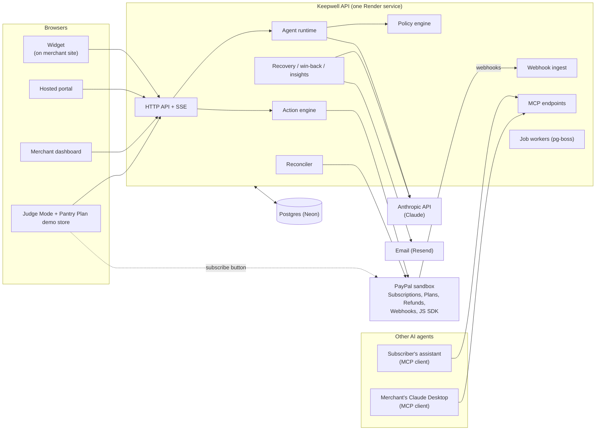

# Keepwell

An honest AI retention agent for businesses that bill through **PayPal Subscriptions**. Built for the [PayPal AI Hackathon 2026](https://paypalaihackathon.devpost.com).

Subscription businesses lose revenue at three moments: when a subscriber goes to cancel, when a renewal payment fails, and when someone cancels inside PayPal and is never asked why. Keepwell handles all three on the real PayPal subscription, and it never makes cancelling harder.

> **Status, 9 Nov 2026, the day after the feature freeze.** On `main`, composed in `apps/api/src/platform.ts`: the PayPal platform layer, policy engine, agent runtime (Claude Haiku 5.5), widget, LLM budget guard, notification outbox, failed-payment recovery, win-back, insights (extraction, SQL aggregates, copilot, insight-to-action), sessions, hosted portal, Judge Mode, Pantry Plan store backend, subscriber MCP, merchant MCP and API keys, and the dashboard in `apps/dashboard` (Insights page included). Several of those routes mount only when the env vars named below are set. The eval harness is on `main`. `GET /evals` and `GET /v1/evals` are not registered on the running server. `render.yaml` names the hosted services. Whether those URLs answer is `TODO(url)`. Present tense means the code is in this repo. A claim this repo cannot prove stays `TODO(...)`.

## See it in 2 minutes

`TODO(url)`: hosted Judge Mode. `render.yaml` names the service `keepwell-judge-demo`. This repo does not show that the URL is up. `TODO(url)`: demo video (under 3 minutes).

Judge Mode is `apps/judge`. Three scenario cards (pause, cheaper plan, honest cancel) each lease a pre-approved sandbox subscription for 30 minutes (`POST /v1/demo/leases`) and tell you what to type. The agent decides the offer from that text. The API routes mount when `JUDGE_LEASE_SECRET`, `WIDGET_TOKEN_SECRET` and `DEMO_MERCHANT_ID` are set. Test credentials go in the Devpost submission form, not in this repo. Locally: `pnpm dev:fake-sessions`, then `pnpm dev:judge` at http://localhost:5180 (see [Run it locally](#run-it-locally)).

## What Keepwell does

| Moment | What happens | State on `main` |
|---|---|---|
| **1. Honest cancel save** | Maya clicks cancel on Pantry Plan. The widget offers a short chat. If the merchant's policy allows a fair fix (pause, cheaper plan, discount, partial refund), the agent offers at most one, and she accepts with a button. Keepwell applies it to the real PayPal subscription. "Cancel now" is always one click. | Policy engine, agent runtime, claims checker, action engine and widget are on `main`. Session routes (`POST /v1/sessions`, `GET /v1/sessions/:id/stream`, `POST /v1/sessions/:id/cancel`) mount when `SESSION_TICKET_SECRET` is set. Without it the API logs that sessions are disabled. `pnpm dev:fake-sessions` still serves the same routes from fakes. |
| **2. Failed-payment recovery** | When Raj's renewal fails, Keepwell reads PayPal's failure reason and next retry time, sends a reason-specific message about a day before the retry, and captures the outstanding balance once he has fixed his payment method. | The recovery engine is on `main` (`mountRecovery` in `platform.ts`) and tested against the mock. Spike [Q5](docs/spikes/Q5.md) forced a real sandbox failure: 3 failed payments, $3.00 outstanding, and PayPal suspended the subscription. The message and the later capture, after funding is restored, were not run. `TODO(results)`. |
| **3. Win-back** | If a subscriber cancels inside PayPal, Keepwell sends one message (never a drip campaign) asking what happened. | On `main`. `registerWinback` records every PayPal-side cancellation. The one message is queued only when the notifier, `PORTAL_URL` and `MAGIC_LINK_SECRET` are all set. Otherwise it records and does not send. Replies are `POST /v1/winback/replies` in that same case. The resubscribe link is omitted: the platform passes no invite-back policy. A sandbox cancel that produced the message is not in the repo. `TODO(results)`. |
| **Insights and copilot** | Every exit conversation becomes structured reasons. Merchants ask questions in a copilot that uses read-only tools, and can approve a proposed action such as creating a new PayPal plan. All numbers come from SQL, not the model. | On `main`. Haiku extraction runs on `session.closed`. Win-back replies are not extracted: `platform.ts` passes `noReplies`. With `SESSION_SECRET` and `DASHBOARD_URL`: `GET /v1/m/insights`, `GET /v1/m/overview`, `GET` and approve/reject on `/v1/m/insight-actions`. `POST /v1/m/copilot/messages` also needs `ANTHROPIC_API_KEY` (Claude Sonnet 5.5). The dashboard page is `#insights`. |
| **MCP surfaces** | A subscriber's own AI assistant can read retention options and cancel through MCP, under the same rules. A merchant MCP lets an external agent propose actions (approval stays in the dashboard). | On `main`, using `@modelcontextprotocol/sdk`. Subscriber: `POST /mcp/subscriber` and `GET /.well-known/keepwell-agent.json`, mounted with sessions. Calls need a portal delegation token, so without `PORTAL_URL` and `MAGIC_LINK_SECRET` they are 401. Merchant: `POST /mcp/merchant` with a `kwk_` key from `POST /v1/m/api-keys`, mounted with merchant sign-in. `propose_action` only inserts a proposed row. A recorded call from Claude Desktop is `TODO(results)`. |
| **Merchant dashboard** | Results, live feed, audit log with chain verification, policy editor, subscriber timeline, and an Insights page (overview, at risk, copilot, action queue, Demo Inbox). | On `main`: `apps/dashboard` (React, Vite). Merchant routes, including `GET /v1/m/audit/verify` and `GET /v1/m/feed`, mount when `SESSION_SECRET` and `DASHBOARD_URL` are set. Onboarding (`POST /v1/m/onboarding/credentials`) also needs sandbox mode and `PAYPAL_CREDENTIALS_ENCRYPTION_KEY`. The timeline is an HTML event list. Bryntum Scheduler is not a dependency. `TODO(licence)`: written confirmation, see [docs/spikes/Q8.md](docs/spikes/Q8.md). |

## How PayPal is central

Keepwell does nothing without a PayPal subscription to act on. The PayPal sandbox is the source of truth; our database is a cache and an intent log.

| PayPal capability | How Keepwell uses it | State |
|---|---|---|
| Subscriptions: suspend, activate, cancel | Pause is suspend plus a scheduled activate. Cancel is cancel. Retries read the subscription first, so nothing is applied twice. | On `main` |
| Subscriptions: revise | Plan changes (downgrade, switch to annual) go through PayPal's buyer approval page, then are confirmed by reading the subscription. | On `main` |
| Subscriptions: price patch, capture | Time-limited discounts and recovering an outstanding balance. The patch path is `.../pricing_scheme/fixed_price`. The action confirms by reading the price back (`confirmsOnApply: false` in `apps/api/src/modules/actions/plans.ts`). | On `main`. Spike [Q4](docs/spikes/Q4.md): inside 10 days PayPal returned 204 and did not apply the new price. The 8 Nov renewal still charged $1.00. The policy withholds the offer when the next billing is under 10 days (`PRICE_CHANGE_MIN_DAYS` in `packages/policy/src/rules.ts`). A PATCH more than 10 days before billing was not run. |
| Plans | Insight-to-action creates a new plan after the merchant approves (`POST /v1/m/insight-actions/:id/approve`, kind `create_plan`). The queue is the dashboard Insights page. | On `main`, with merchant sign-in |
| Refunds v2 | Partial refunds use `POST /v2/payments/captures/{id}/refund` with `PayPal-Request-Id`. Spike Q1 confirmed that subscription transaction ids work as capture ids ([docs/spikes/Q1.md](docs/spikes/Q1.md)). | On `main` |
| Webhooks | Verified through PayPal's verify-webhook-signature API on the raw body. A webhook is only a hint: Keepwell re-fetches the subscription, diffs it against the last snapshot and derives events from the diff. This makes duplicate, late and missing webhooks harmless. A reconciler sweeps for anything missed. | On `main` |
| JS SDK | Pantry Plan (`apps/demo-store`) loads `https://www.paypal.com/sdk/js`. The browser then calls `POST /v1/demo-store/subscriptions`, which GETs the subscription from PayPal before it issues a shopper token. | On `main` when `WIDGET_TOKEN_SECRET` and `DEMO_MERCHANT_ID` are set. With no `PAYPAL_CLIENT_ID` the page badges `FAKE PAYPAL`. `render.yaml` leaves the store's client id and plan ids unset until a person sets them. A hosted sandbox subscribe is `TODO(results)`. |

Everything runs against the PayPal **sandbox** only. Nothing in this project touches live PayPal.

## How AI is used, and how it is constrained

Claude does two kinds of work: Claude Haiku 5.5 holds the short conversation, classifies the cancel reason and tags insights; Claude Sonnet 5.5 powers the merchant copilot. Failed-payment and win-back emails are fixed templates filled from verified facts, not model text. The model is boxed in by design laws (full list in [docs/ARCHITECTURE.md](docs/ARCHITECTURE.md#2-ten-design-laws)):

1. **Cancel never depends on the AI.** The cancel button makes no model call. If our API is down, the widget still links to PayPal's own autopay page.
2. **PayPal is the source of truth.** A webhook means "go and look", never "this is the state".
3. **The AI proposes, the policy decides, the person clicks.** The model can only pick from a menu of offers that the policy engine computed. The policy re-checks the pick, and again when the subscriber accepts. Consent is a button click, never the word "yes" in text.
4. **Terms come from data.** Prices, dates and durations on an offer card are rendered from the offer object. A claims checker rejects any model text that states figures, dates, promises or pressure.
5. **Every side effect is an Action**: idempotent, serialized per subscription, and audited.
6. **Everything degrades to something that works.** If the model is down, slow or over budget, the session falls back to reason chips and the policy's default offer, with template text.
7. **Contracts first.** The workstreams meet only through types in `packages/contracts`.
8. **Real sandbox in the demo.** Simulation is used only where PayPal makes reality impossible, and is badged `SIMULATED`.
9. **No dark patterns.** At most one offer per session, no guilt copy, no false urgency, and "I want to cancel" means cancel now.
10. **Cheap.** Free tiers plus a small prepaid AI credit, with a daily budget guard.

Prompt injection: whatever a subscriber types, the model can only change which offer on the menu it picks. The menu, the policy check and the card rendering are outside its reach.

## Architecture



This is the target design. Today on `main`: the API, webhook ingest, agent runtime, policy engine, action engine, reconciler, job workers, audit log, notifications outbox, recovery, win-back, insights (copilot and insight actions included), sessions, portal, Judge Mode, Pantry Plan store, both MCP servers, and the dashboard. A route that needs a secret or a URL stays off until that variable is set (`platform.ts` logs which one). The eval scoreboard handlers are in the repo and are not registered on the server. Stack: TypeScript (strict), Fastify, Drizzle on Postgres (Neon) with row-level security, pg-boss, zod at every boundary, Preact widget in Shadow DOM, React and Vite for the dashboard, Preact for the portal and Judge Mode, Vitest and fast-check.

Other safety properties: the audit log is hash-chained with a verify endpoint; tenant isolation is enforced by Postgres row-level security; the failure behaviour of each component is tabulated in [ARCHITECTURE.md section 9](docs/ARCHITECTURE.md#9-failure-mode-matrix).

## Run it locally

Needs Node 22.12+ (24 recommended, see `.node-version`) and pnpm 10.34.7 (set in `package.json`).

```bash
git clone https://github.com/NotArnav03/keepwell.git
cd keepwell
corepack enable pnpm        # or: npm i -g pnpm@10.34.7
pnpm install
cp .env.example .env        # then fill it in yourself
```

The API needs a Postgres database. Set `DATABASE_URL_UNPOOLED` to a direct (non-pooler) Neon connection string; the API refuses a `-pooler` host. `RUN_MIGRATIONS=true` applies migrations on start.

### Mock mode (no PayPal or Anthropic credentials)

`packages/paypal-mock` is a fake PayPal REST API with the same paths, status codes, error bodies and debug-id headers, seeded with the Pantry Plan fixtures.

```bash
# .env: PAYPAL_USE_MOCK=true  PAYPAL_MOCK_URL=http://localhost:4010
pnpm dev:paypal-mock        # http://localhost:4010
pnpm dev:api                # http://localhost:3000  (/healthz, /readyz)
pnpm seed                   # sets up the Pantry Plan demo merchant (safe to re-run)
```

To work on the widget without the API, `pnpm dev:fake-sessions` serves the sessions API from fakes and `pnpm dev:widget` runs the widget (see `apps/api/src/modules/sessions/README.md`).

### Sandbox mode

Create **US** sandbox business and personal accounts (India-region sandbox accounts fail at subscription approval, see [docs/spikes/Q1.md](docs/spikes/Q1.md)). Then in `.env`:

```bash
PAYPAL_USE_MOCK=false
PAYPAL_API_BASE=https://api-m.sandbox.paypal.com
PAYPAL_CLIENT_ID=...        # your sandbox app
PAYPAL_CLIENT_SECRET=...
PAYPAL_WEBHOOK_ID=...
ANTHROPIC_API_KEY=...       # optional; without it the session falls back to reason chips
LLM_DAILY_BUDGET_USD=0.25
```

Use sandbox credentials only. `pnpm seed` then creates the product, plans and demo merchant in your sandbox. The browser apps are on `main`: `pnpm dev:store` (http://localhost:5176), `pnpm dev:portal` (http://localhost:5178), `pnpm dev:judge` (http://localhost:5180), and `pnpm --filter @keepwell/dashboard dev` (Vite's default, http://localhost:5173). A full sandbox browser run (subscribe, pause, resume, cancel) with timestamps and debug ids is `TODO(results)`.

## Repo map

| Path | What it is | State on `main` |
|---|---|---|
| `apps/api` | Fastify API, webhooks, workers, reconciler, audit. Modules include `paypal`, `webhooks`, `actions`, `reconcile`, `audit`, `jobs`, `agent`, `policy`, `sessions`, `recovery`, `winback`, `notify`, `insights`, `portal`, `mcp`, `demo`, `merchant`, `pool` | On `main`. Sessions, portal, Judge Mode, store, merchant and copilot routes mount only with the env vars named above |
| `apps/dashboard` | Merchant dashboard, React and Vite, Insights page included | On `main`. Sign-in needs `SESSION_SECRET` and `DASHBOARD_URL` |
| `apps/portal` | Hosted portal (magic link, widget, delegations), Preact | On `main`. API routes need sessions plus `PORTAL_URL` and `MAGIC_LINK_SECRET` |
| `apps/judge` | Judge Mode page, Preact | On `main`. API routes need `JUDGE_LEASE_SECRET`, `WIDGET_TOKEN_SECRET` and `DEMO_MERCHANT_ID` |
| `apps/demo-store` | Pantry Plan store and the PayPal JS SDK button | On `main`. Backend needs `WIDGET_TOKEN_SECRET` and `DEMO_MERCHANT_ID`. No client id means `FAKE PAYPAL` |
| `packages/contracts` | Every zod schema and shared type | On `main` |
| `packages/policy` | Pure policy engine: `computeMenu`, `evaluate`, `explain` | On `main` |
| `packages/widget` | Preact widget in Shadow DOM | On `main` |
| `packages/paypal-mock` | Fake PayPal server for tests and offline work | On `main` |
| `packages/db` | Drizzle schema and migrations | On `main` |
| `packages/evals` | Red-team and quality eval harness | On `main` (personas, harness, runner, committed adversarial results). Scoreboard routes are not registered in `platform.ts` |
| `packages/ui` | Light and dark design tokens, used by the dashboard | On `main` |
| `tools/seed`, `tools/pool-refill` | Demo merchant seed (`pnpm seed`), judge subscription pool refill | Seed and `pnpm pool:refill` on `main` |
| `docs/` | Architecture, contracts, team plan, spikes, ADRs, submission drafts | See below |

## Tests

```bash
pnpm typecheck && pnpm lint && pnpm test     # every package, via Turborepo
pnpm check                                   # the above plus the Prettier check; what CI runs
```

Unit tests never call real PayPal or the Anthropic API: they use `packages/paypal-mock` and a fake LLM. The policy engine has unit tests and property-based tests (fast-check). CI also runs a secret scan and a database test job on Postgres 18.

The policy package's Vitest config sets a 100% branch, function, line and statement threshold (`packages/policy/vitest.config.ts`). No coverage report is committed, so this README does not quote a percentage. `TODO(results)`: latest `pnpm check` result and the coverage figure on the submitted commit. `TODO(results)`: sandbox end-to-end run (subscribe, pause, resume, cancel).

## Evals

The harness in [packages/evals](packages/evals/README.md) has 404 personas: 300 everyday subscribers in English, Hindi and Spanish, and 104 attackers. The hard gates are **0 policy violations** and **1 click to cancel when the persona wants to leave**. Those are gates the harness enforces. The committed adversarial run uses a scripted jailbroken model, not Claude. It passed both gates: `policyViolations` 0, `maxClicksToCancel` 1, `claimsCaught` 204, `deniedPicks` 132, over 404 sessions (`packages/evals/results/adversarial.json`). [docs/CHAOS-REPORT.md](docs/CHAOS-REPORT.md) records those same adversarial figures for the prompt-injection drill, and says the paid Haiku run is still to do. `darkPatternScore` in that file is null. The handlers `GET /evals` and `GET /v1/evals` live in `apps/api/src/modules/agent/evals/routes.ts`. `startPlatform` does not register them, so the running API does not serve a scoreboard. `TODO(results)`: a real-model run on the submitted commit, and a scoreboard URL once those routes are mounted.

## Chaos testing

Chaos day is 9 Nov. The report is [docs/CHAOS-REPORT.md](docs/CHAOS-REPORT.md). It records the agent drills (revoked Anthropic key, spent daily budget, prompt injection against a scripted jailbroken model) and the notification drills (the same `payment_failed` delivered three times opens one case and queues one message; with the email provider down the message is retried and sent once). The API-kill, dropped-webhook, PayPal 5xx, widget and dashboard rows in that file are Open. `TODO(results)`: those open sections. Quote only what the report records.

## What is simulated

- **Time machine.** Pausing waits a number of billing cycles, which a judge cannot sit through. Judge Mode's "Resume now" calls `POST /v1/demo/time-machine/resume/:subscriptionId`. That makes the scheduled resume due now and creates a real PayPal `activate` Action. The response and the audit entry are `simulated: true`, labelled `TIME SHIFT` (`apps/api/src/modules/demo/judge.ts`, and the badge on `apps/judge`). The route exists when Judge Mode's three env vars are set.
- **Failed payment.** A real renewal failure can be forced on the PayPal sandbox. Spike [Q5](docs/spikes/Q5.md) did it once: a daily plan, a buyer with no working funding source, 3 failed payments, $3.00 outstanding, and PayPal suspended the subscription itself. Failures are read from `billing_info`, not from the transactions list. Forcing one takes days of billing cycles. The Judge Mode page does not inject a failed payment. `sendDunningNow` in the recovery module can flag a message `simulated`, and it is not mounted as an HTTP route. Restoring funding and then capturing the outstanding balance was not run on the sandbox. `TODO(results)`.
- **Price change inside 10 days.** Keepwell does not pretend one succeeded. Spike [Q4](docs/spikes/Q4.md) sent a price PATCH inside the 10-day window. PayPal returned 204, the stored price stayed $1.00, and the 8 Nov renewal charged $1.00. The policy leaves the discount off the menu in that window. The case of a PATCH more than 10 days before billing was not run, so that half rests on PayPal's documentation.
- **Demo Inbox.** Sandbox buyers have no real inbox. `GET /v1/m/outbox` (mounted with merchant sign-in) and the dashboard Insights tab "Demo Inbox" show the outbox, with a `SIMULATED` badge on simulated rows. A simulated row never calls the email provider (`apps/api/src/modules/notify/dispatcher.ts`). Resend is used only when `RESEND_API_KEY` is set and the row is not simulated. `render.yaml` leaves that key blank on staging so sandbox addresses are not mailed. Delivery to a real inbox is `TODO(results)`. The demo merchant's portal sign-in mail is flagged simulated (`merchantId === DEMO_MERCHANT_ID`).
- **Mock PayPal.** Local development and unit tests use `packages/paypal-mock`, not PayPal. The hosted demo uses the real PayPal sandbox.
- **Data.** All data is sandbox or fictional (Pantry Plan, Maya, Raj).

## Team

| Member | GitHub | Workstream | Owns |
|---|---|---|---|
| Arnav | @NotArnav03 | M1 Rails | PayPal gateway, webhooks, action engine, reconciler, audit log, infra, judge pool |
| Ishan | @IshanGite | M2 Brain | Policy engine, agent runtime, claims checker, eval harness |
| Aditya | @inslot2525-ctrl | M3 Surfaces | Widget, sessions API, portal, Pantry Plan demo store, Judge Mode, MCP servers |
| Ayush | @Ayush32-creator | M4 Cockpit | Merchant dashboard, Bryntum timeline, policy editor, onboarding, video |
| Om | @OMEExZORO | M5 Growth | Failed-payment recovery, win-back, notifications, insights + copilot, write-up |

## For contributors

Read these first:

1. [CLAUDE.md](CLAUDE.md): rules for everyone and every Claude Code session
2. [docs/ARCHITECTURE.md](docs/ARCHITECTURE.md): the system and the ten design laws
3. [docs/CONTRACTS.md](docs/CONTRACTS.md): the shared types and APIs
4. [docs/TEAM-PLAN.md](docs/TEAM-PLAN.md): split, milestones, cut list, submission checklist
5. [docs/submission/CHECKLIST.md](docs/submission/CHECKLIST.md) and [docs/submission/devpost.md](docs/submission/devpost.md): submission status and the Devpost draft

Setup and workflow:

```bash
git config core.hooksPath .githooks          # blocks pushes to main
git switch -c <your-name>/<topic> origin/main
```

If `corepack enable` fails with EPERM on Windows, run `corepack enable pnpm --install-directory "$HOME/.local/bin"` (any folder on your PATH works) or `npm i -g pnpm@10.34.7`. Nothing is pushed to `main` directly: branch, PR, checks pass, squash merge.

| Command | What it does |
|---|---|
| `pnpm dev:api` | API on http://localhost:3000 with reload |
| `pnpm dev:paypal-mock` | Fake PayPal on http://localhost:4010 |
| `pnpm dev:fake-sessions` | Sessions API on fakes, for building the widget |
| `pnpm dev:widget` | Widget dev server |
| `pnpm dev:store` | Pantry Plan on http://localhost:5176 |
| `pnpm dev:portal` | Hosted portal on http://localhost:5178 |
| `pnpm dev:judge` | Judge Mode on http://localhost:5180 |
| `pnpm --filter @keepwell/dashboard dev` | Merchant dashboard (Vite, http://localhost:5173) |
| `pnpm seed` | Set up the Pantry Plan demo merchant |
| `pnpm pool:refill` | Create sandbox subscriptions for the judge pool. A person approves each one. See [docs/spikes/Q10.md](docs/spikes/Q10.md) |
| `pnpm db:generate` / `pnpm db:migrate` | Drizzle migrations |
| `pnpm typecheck` / `pnpm lint` / `pnpm test` | Every package, through Turborepo (cached) |
| `pnpm check` | All of the above plus the Prettier check |
| `pnpm format` | Fix formatting |

Key dates (IST): contracts frozen 29 Oct; walking skeleton 2 Nov; all three moments end to end 5 Nov; feature freeze 8 Nov 23:59; submitted 12 Nov 20:00 (real deadline 13 Nov 01:30).

## License

MIT. See [LICENSE](LICENSE).
