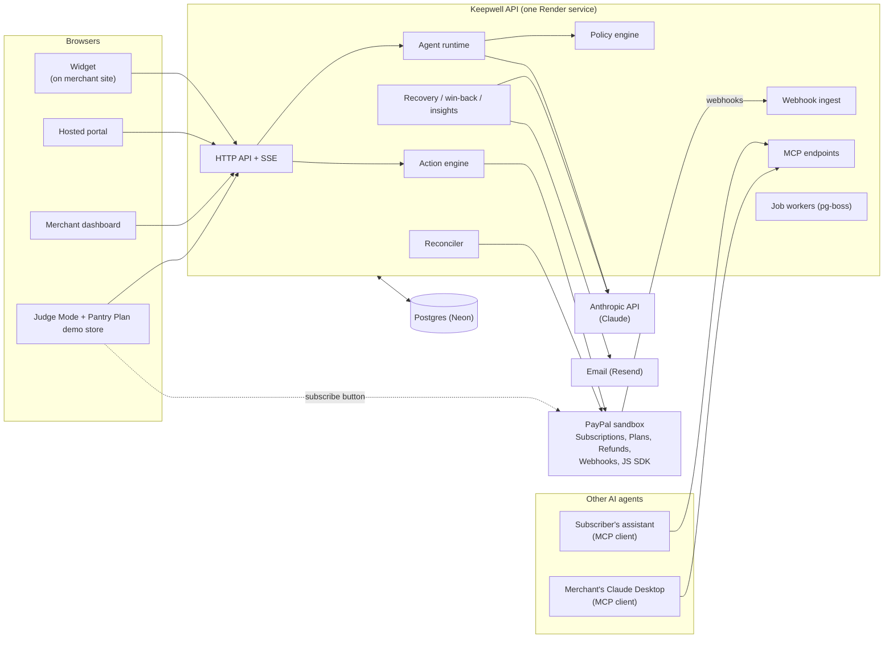

# Keepwell

An honest AI retention agent for businesses that bill through **PayPal Subscriptions**. Built for the [PayPal AI Hackathon 2026](https://paypalaihackathon.devpost.com).

Subscription businesses lose revenue at three moments: when a subscriber goes to cancel, when a renewal payment fails, and when someone cancels inside PayPal and is never asked why. Keepwell handles all three on the real PayPal subscription, and it never makes cancelling harder.

> **Status, 7 Nov 2026.** On `main`: the PayPal platform layer, policy engine, agent runtime (Claude Haiku 5.5), widget, the LLM budget guard, the eval harness and public scoreboard, the notification outbox (Resend, with a Demo Inbox API), the failed-payment recovery engine, the real sessions module, the Judge Mode API and page, and the hosted portal. The sessions and Judge Mode code is on `main` but not yet mounted in the running API, so nothing here is claimed as working end to end on the hosted demo yet. Win-back, insights, the dashboard and the MCP servers are in review or still being built. This README is written in present tense only for what is on `main` today. Everything else is marked `TODO(shipping by 8 Nov)` and is removed or reworded if it misses the feature freeze. The status and the "State on `main`" columns are refreshed again after the freeze.

## See it in 2 minutes

`TODO(url)`: Judge Mode link (hosted `prod-demo`). `TODO(url)`: demo video (under 3 minutes). `TODO(shipping by 8 Nov)`: Judge Mode itself.

The plan for Judge Mode: open the link, get a pre-approved sandbox subscription on the fictional "Pantry Plan" store, and run three one-click scenarios (pause, downgrade, honest cancel). Test credentials go in the Devpost submission form, not in this repo. Until Judge Mode ships, you can run the platform locally (see [Run it locally](#run-it-locally)).

## What Keepwell does

| Moment | What happens | State on `main` |
|---|---|---|
| **1. Honest cancel save** | Maya clicks cancel on Pantry Plan. The widget offers a short chat. If the merchant's policy allows a fair fix (pause, cheaper plan, discount, partial refund), the agent offers at most one, and she accepts with a button. Keepwell applies it to the real PayPal subscription. "Cancel now" is always one click. | Policy engine, agent runtime, claims checker, action engine, widget and session routes exist. The real sessions module is on `main` but not yet mounted in the running API (`TODO(shipping by 8 Nov)`); the widget runs against a fake sessions server until it is. |
| **2. Failed-payment recovery** | When Raj's renewal fails, Keepwell reads PayPal's failure reason and next retry time, sends a reason-specific message about a day before the retry, and captures the outstanding balance once he has fixed his payment method. | The recovery engine is on `main` and tested against the mock. The spike [Q5](docs/spikes/Q5.md) forced a real renewal failure on the sandbox once; the whole recovery loop on a real failure has not been run end to end. |
| **3. Win-back** | If a subscriber cancels inside PayPal, Keepwell sends one message (never a drip campaign) asking what happened. | `TODO(shipping by 8 Nov)`. Cancel-inside-PayPal detection (diffing fetched PayPal state) is in the webhook pipeline. |
| **Insights and copilot** | Every exit conversation becomes structured reasons. Merchants ask questions in a copilot that uses read-only tools, and can approve a proposed action such as creating a new PayPal plan. All numbers come from SQL, not the model. | `TODO(shipping by 8 Nov)`. Contract types are on `main`. |
| **MCP surfaces** | A subscriber's own AI assistant can read retention options and cancel through MCP, under the same rules. A merchant MCP lets an external agent propose actions (approval stays in the dashboard). | `TODO(shipping by 8 Nov)`. Cut-list items. |
| **Merchant dashboard** | Results, live feed, audit log with chain verification, policy editor, and a Bryntum Scheduler subscriber timeline. | `TODO(shipping by 8 Nov)`. |

## How PayPal is central

Keepwell does nothing without a PayPal subscription to act on. The PayPal sandbox is the source of truth; our database is a cache and an intent log.

| PayPal capability | How Keepwell uses it | State |
|---|---|---|
| Subscriptions: suspend, activate, cancel | Pause is suspend plus a scheduled activate. Cancel is cancel. Retries read the subscription first, so nothing is applied twice. | On `main` |
| Subscriptions: revise | Plan changes (downgrade, switch to annual) go through PayPal's buyer approval page, then are confirmed by reading the subscription. | On `main` |
| Subscriptions: price patch, capture | Time-limited discounts and recovering an outstanding balance. | On `main` |
| Plans | Insight-to-action creates a new plan after the merchant approves. | Action type on `main`; the insight UI is `TODO(shipping by 8 Nov)` |
| Refunds v2 | Partial refunds use `POST /v2/payments/captures/{id}/refund` with `PayPal-Request-Id`. Spike Q1 confirmed that subscription transaction ids work as capture ids ([docs/spikes/Q1.md](docs/spikes/Q1.md)). | On `main` |
| Webhooks | Verified through PayPal's verify-webhook-signature API on the raw body. A webhook is only a hint: Keepwell re-fetches the subscription, diffs it against the last snapshot and derives events from the diff. This makes duplicate, late and missing webhooks harmless. A reconciler sweeps for anything missed. | On `main` |
| JS SDK | The Pantry Plan demo store uses the subscribe button. | `TODO(shipping by 8 Nov)` |

Everything runs against the PayPal **sandbox** only. Nothing in this project touches live PayPal.

## How AI is used, and how it is constrained

Claude does two kinds of work: Claude Haiku 5.5 holds the short conversation, classifies the cancel reason and tags insights; Claude Sonnet 5.5 powers the merchant copilot. Failed-payment and win-back emails are fixed templates filled from verified facts, not model text. The model is boxed in by design laws (full list in [docs/ARCHITECTURE.md](docs/ARCHITECTURE.md#2-ten-design-laws)):

1. **Cancel never depends on the AI.** The cancel button makes no model call. If our API is down, the widget still links to PayPal's own autopay page.
2. **PayPal is the source of truth.** A webhook means "go and look", never "this is the state".
3. **The AI proposes, the policy decides, the person clicks.** The model can only pick from a menu of offers that the policy engine computed. The policy re-checks the pick, and again when the subscriber accepts. Consent is a button click, never the word "yes" in text.
4. **Terms come from data.** Prices, dates and durations on an offer card are rendered from the offer object. A claims checker rejects any model text that states figures, dates, promises or pressure.
5. **Every side effect is an Action**: idempotent, serialized per subscription, and audited.
6. **Everything degrades to something that works.** If the model is down, slow or over budget, the session falls back to reason chips and the policy's default offer, with template text.
7. **Contracts first.** The workstreams meet only through types in `packages/contracts`.
8. **Real sandbox in the demo.** Simulation is used only where PayPal makes reality impossible, and is badged `SIMULATED`.
9. **No dark patterns.** At most one offer per session, no guilt copy, no false urgency, and "I want to cancel" means cancel now.
10. **Cheap.** Free tiers plus a small prepaid AI credit, with a daily budget guard.

Prompt injection: whatever a subscriber types, the model can only change which offer on the menu it picks. The menu, the policy check and the card rendering are outside its reach.

## Architecture



This is the target design. Today on `main`: the API, webhook ingest, agent runtime, policy engine, action engine, reconciler, job workers, audit log, notifications outbox, recovery engine, sessions module, portal and Judge Mode code. Not yet on `main`: the win-back and insights modules, MCP endpoints and the dashboard (`TODO(shipping by 8 Nov)`). Stack: TypeScript (strict), Fastify, Drizzle on Postgres (Neon) with row-level security, pg-boss, zod at every boundary, Preact widget in Shadow DOM, Vitest and fast-check.

Other safety properties: the audit log is hash-chained with a verify endpoint; tenant isolation is enforced by Postgres row-level security; the failure behaviour of each component is tabulated in [ARCHITECTURE.md section 9](docs/ARCHITECTURE.md#9-failure-mode-matrix).

## Run it locally

Needs Node 22.12+ (24 recommended, see `.node-version`) and pnpm 10.34.7 (set in `package.json`).

```bash
git clone https://github.com/NotArnav03/keepwell.git
cd keepwell
corepack enable pnpm        # or: npm i -g pnpm@10.34.7
pnpm install
cp .env.example .env        # then fill it in yourself
```

The API needs a Postgres database. Set `DATABASE_URL_UNPOOLED` to a direct (non-pooler) Neon connection string; the API refuses a `-pooler` host. `RUN_MIGRATIONS=true` applies migrations on start.

### Mock mode (no PayPal or Anthropic credentials)

`packages/paypal-mock` is a fake PayPal REST API with the same paths, status codes, error bodies and debug-id headers, seeded with the Pantry Plan fixtures.

```bash
# .env: PAYPAL_USE_MOCK=true  PAYPAL_MOCK_URL=http://localhost:4010
pnpm dev:paypal-mock        # http://localhost:4010
pnpm dev:api                # http://localhost:3000  (/healthz, /readyz)
pnpm seed                   # sets up the Pantry Plan demo merchant (safe to re-run)
```

To work on the widget without the API, `pnpm dev:fake-sessions` serves the sessions API from fakes and `pnpm dev:widget` runs the widget (see `apps/api/src/modules/sessions/README.md`).

### Sandbox mode

Create **US** sandbox business and personal accounts (India-region sandbox accounts fail at subscription approval, see [docs/spikes/Q1.md](docs/spikes/Q1.md)). Then in `.env`:

```bash
PAYPAL_USE_MOCK=false
PAYPAL_API_BASE=https://api-m.sandbox.paypal.com
PAYPAL_CLIENT_ID=...        # your sandbox app
PAYPAL_CLIENT_SECRET=...
PAYPAL_WEBHOOK_ID=...
ANTHROPIC_API_KEY=...       # optional; without it the session falls back to reason chips
LLM_DAILY_BUDGET_USD=0.25
```

Use sandbox credentials only. `pnpm seed` then creates the product, plans and demo merchant in your sandbox. `TODO(shipping by 8 Nov)`: the full browser flow (Pantry Plan, Judge Mode) once those apps land.

## Repo map

| Path | What it is | State on `main` |
|---|---|---|
| `apps/api` | Fastify API, webhooks, workers, reconciler, audit. Modules: `paypal`, `webhooks`, `actions`, `reconcile`, `audit`, `jobs`, `agent`, `policy`, `sessions` | On `main` (sessions is routes plus fakes) |
| `apps/dashboard`, `apps/portal`, `apps/judge`, `apps/demo-store` | Merchant dashboard, hosted portal, Judge Mode, Pantry Plan store | Scaffolds only, `TODO(shipping by 8 Nov)` |
| `packages/contracts` | Every zod schema and shared type | On `main` |
| `packages/policy` | Pure policy engine: `computeMenu`, `evaluate`, `explain` | On `main` |
| `packages/widget` | Preact widget in Shadow DOM | On `main` |
| `packages/paypal-mock` | Fake PayPal server for tests and offline work | On `main` |
| `packages/db` | Drizzle schema and migrations | On `main` |
| `packages/evals` | Red-team and quality eval harness | On `main` (harness, runner, public scoreboard) |
| `packages/ui` | Shared design tokens | Placeholder |
| `tools/seed`, `tools/pool-refill` | Demo merchant seed (`pnpm seed`), judge subscription pool refill | Seed and `pnpm pool:refill` on `main` |
| `docs/` | Architecture, contracts, team plan, spikes, ADRs, submission drafts | See below |

## Tests

```bash
pnpm typecheck && pnpm lint && pnpm test     # every package, via Turborepo
pnpm check                                   # the above plus the Prettier check; what CI runs
```

Unit tests never call real PayPal or the Anthropic API: they use `packages/paypal-mock` and a fake LLM. The policy engine has unit tests and property-based tests (fast-check), with 100% branch coverage as the target. CI also runs a secret scan and a database test job on Postgres 18.

`TODO(results)`: latest `pnpm check` result and policy coverage figure on the submitted commit. `TODO(results)`: sandbox end-to-end run (subscribe, pause, resume, cancel).

## Evals

Every agent change is tested against 404 personas: 300 everyday subscribers in English, Hindi and Spanish, and 104 attackers. The hard gates are **0 policy violations** and **1 click to cancel when the persona wants to leave**. These are gates the harness enforces, not a claimed result: the numbers are whatever the latest run on the submitted commit shows, on the API's public `/evals` page (JSON at `/v1/evals`). How it works: [packages/evals](packages/evals/README.md). `TODO(results)`: scoreboard link and the numbers from a run on the submitted commit.

## Chaos testing

Chaos day is planned for 9 Nov: each owner breaks their component on staging (kill the API mid-action, drop webhooks, return 500 from the mock PayPal, revoke the Anthropic key) and checks the behaviour against the failure-mode matrix.

`TODO(results)`: link to the chaos report once it exists.

## What is simulated

- **Time machine.** Pausing waits a number of billing cycles, which a judge cannot sit through. Judge Mode will let you trigger the scheduled resume now. That is a real PayPal `activate` call, labelled as a time shift. `TODO(shipping by 8 Nov)`.
- **Failed payment.** A real renewal failure can be forced on the PayPal sandbox: spike [Q5](docs/spikes/Q5.md) did it once (a daily plan, a buyer with no working funding source; PayPal counted 3 failed payments and suspended the subscription itself). Forcing one takes days of real billing cycles, so Judge Mode injects a failed-payment event through the simulator path instead, and it is badged `SIMULATED` in the UI and the audit log. `TODO(results)`: confirm Judge Mode's wording once it is wired.
- **Demo Inbox.** Sandbox buyers have no real inbox, so on the hosted demo outgoing emails are not sent: they show in the Demo Inbox (API on `main`, dashboard view `TODO(shipping by 8 Nov)`) so judges can read them.
- **Mock PayPal.** Local development and unit tests use `packages/paypal-mock`, not PayPal. The hosted demo uses the real PayPal sandbox.
- **Data.** All data is sandbox or fictional (Pantry Plan, Maya, Raj).

## Team

| Member | GitHub | Workstream | Owns |
|---|---|---|---|
| Arnav | @NotArnav03 | M1 Rails | PayPal gateway, webhooks, action engine, reconciler, audit log, infra, judge pool |
| Ishan | @IshanGite | M2 Brain | Policy engine, agent runtime, claims checker, eval harness |
| Aditya | @inslot2525-ctrl | M3 Surfaces | Widget, sessions API, portal, Pantry Plan demo store, Judge Mode, MCP servers |
| Ayush | @Ayush32-creator | M4 Cockpit | Merchant dashboard, Bryntum timeline, policy editor, onboarding, video |
| Om | @OMEExZORO | M5 Growth | Failed-payment recovery, win-back, notifications, insights + copilot, write-up |

## For contributors

Read these first:

1. [CLAUDE.md](CLAUDE.md): rules for everyone and every Claude Code session
2. [docs/ARCHITECTURE.md](docs/ARCHITECTURE.md): the system and the ten design laws
3. [docs/CONTRACTS.md](docs/CONTRACTS.md): the shared types and APIs
4. [docs/TEAM-PLAN.md](docs/TEAM-PLAN.md): split, milestones, cut list, submission checklist
5. [docs/submission/CHECKLIST.md](docs/submission/CHECKLIST.md) and [docs/submission/devpost.md](docs/submission/devpost.md): submission status and the Devpost draft

Setup and workflow:

```bash
git config core.hooksPath .githooks          # blocks pushes to main
git switch -c <your-name>/<topic> origin/main
```

If `corepack enable` fails with EPERM on Windows, run `corepack enable pnpm --install-directory "$HOME/.local/bin"` (any folder on your PATH works) or `npm i -g pnpm@10.34.7`. Nothing is pushed to `main` directly: branch, PR, checks pass, squash merge.

| Command | What it does |
|---|---|
| `pnpm dev:api` | API on http://localhost:3000 with reload |
| `pnpm dev:paypal-mock` | Fake PayPal on http://localhost:4010 |
| `pnpm dev:fake-sessions` | Sessions API on fakes, for building the widget |
| `pnpm dev:widget` | Widget dev server |
| `pnpm seed` | Set up the Pantry Plan demo merchant |
| `pnpm db:generate` / `pnpm db:migrate` | Drizzle migrations |
| `pnpm typecheck` / `pnpm lint` / `pnpm test` | Every package, through Turborepo (cached) |
| `pnpm check` | All of the above plus the Prettier check |
| `pnpm format` | Fix formatting |

Key dates (IST): contracts frozen 29 Oct; walking skeleton 2 Nov; all three moments end to end 5 Nov; feature freeze 8 Nov 23:59; submitted 12 Nov 20:00 (real deadline 13 Nov 01:30).

## License

MIT. See [LICENSE](LICENSE).
