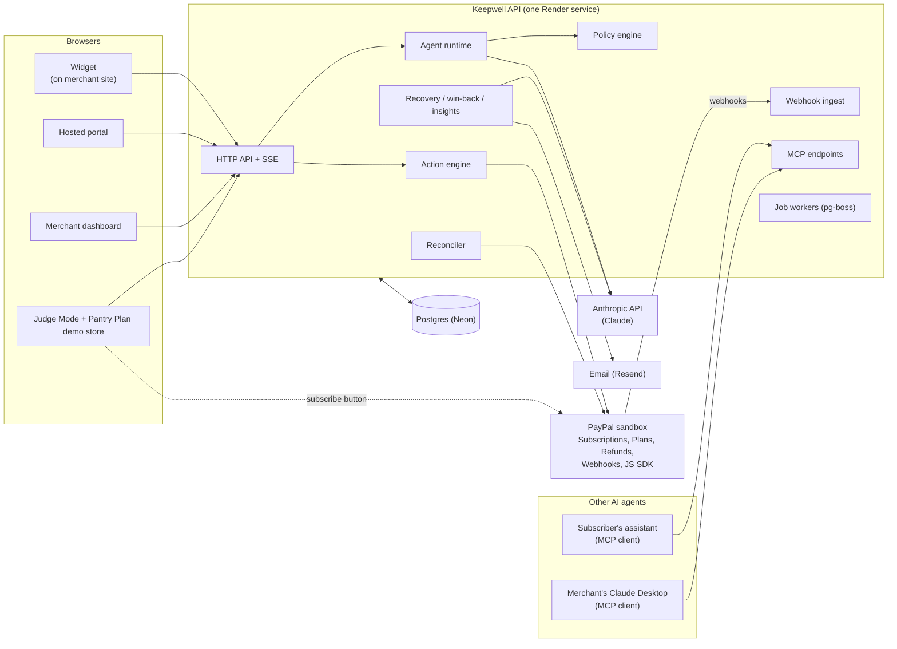
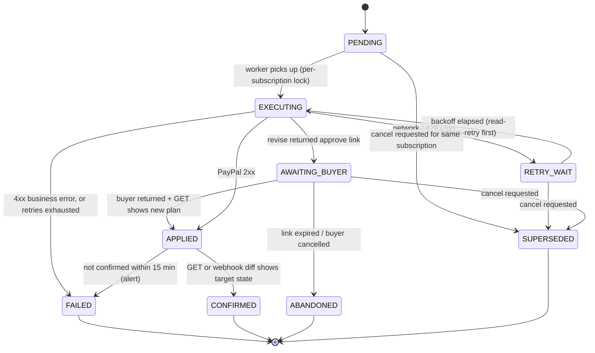
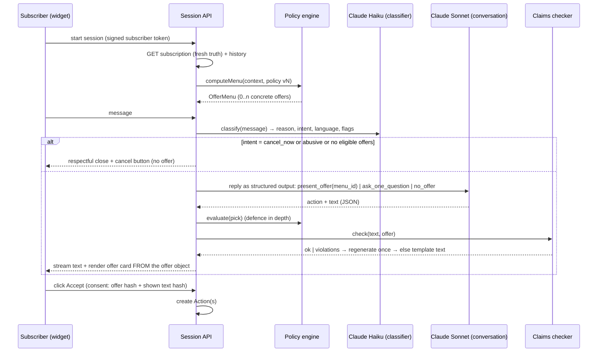
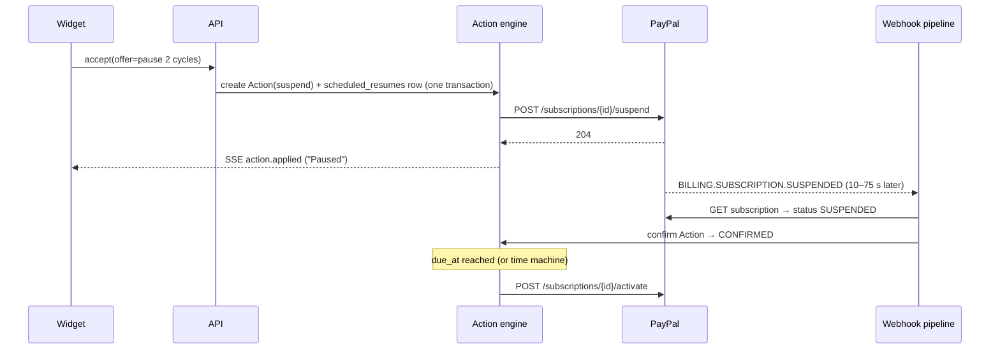

# Keepwell: System Architecture

Status: **v1 draft, 28 Oct 2026**. Owner: whole team. Changes go through a PR that two workstream owners approve.
Read with: [CONTRACTS.md](CONTRACTS.md) (the shared types and APIs everyone builds against) and [TEAM-PLAN.md](TEAM-PLAN.md) (who builds what, and when).

"Keepwell" is a working name.

---

## 0. The product in one paragraph

Keepwell is an honest AI retention platform for businesses that bill through **PayPal Subscriptions**. When a subscriber goes to cancel, an agent has a short conversation, offers at most one fair fix that the merchant's policy allows, and applies it **to the real PayPal subscription** (pause, downgrade, discount, refund). Cancelling is always one click and never depends on the AI. The same platform recovers failed payments using PayPal's own failure reasons and retry times, wins back subscribers who cancelled inside PayPal, turns every exit conversation into insights the merchant can act on (including creating new PayPal plans), and exposes all of this to **other AI agents** through MCP. Every action is idempotent, reconciled against PayPal, and written to a tamper-evident audit log.

---

## 1. Scope, in three tiers

| Tier | Capability | Owner |
|---|---|---|
| **Core** (the demo fails without it) | C1 Cancel-moment agent in an embeddable widget | M2 + M3 |
| | C2 Policy engine: the AI chooses only from offers the policy computed | M2 |
| | C3 Action engine: pause, resume, revise, discount, refund, capture, cancel on real PayPal | M1 |
| | C4 Verified webhook pipeline + reconciler (PayPal is the source of truth) | M1 |
| | C5 Merchant dashboard: results, live feed, audit log, policy editor | M4 |
| | C6 Failed-payment recovery tuned to PayPal's reason code and retry time | M5 |
| | C7 Judge Mode: anyone can run the real flow on sandbox in 2 minutes | M3 + M1 |
| **Differentiators** | D1 Insights copilot + insight-to-action (creates real PayPal plans after approval) | M5 |
| | D2 Win-back for subscribers who cancelled inside PayPal | M5 |
| | D3 Hash-chained, verifiable audit log with "explain this decision" | M1 + M4 |
| | D4 Red-team eval harness with a public scoreboard (target: 0 policy violations) | M2 |
| | D5 Subscriber timeline on Bryntum Scheduler (sponsor prize) | M4 |
| | D6 Zero-config onboarding: paste sandbox credentials, webhooks and data set up automatically | M4 |
| | D7 Hosted cancel portal (magic link) for merchants without their own site | M3 |
| **Moonshots** (build only after Core is green) | X1 **Agent-to-agent retention**: a subscriber's own AI assistant can query options and cancel through MCP, under the same honest rules | M3 |
| | X2 Merchant MCP server: run retention from Claude Desktop | M3 |
| | X3 Upstream PR to `paypal/agent-toolkit` adding suspend / activate / revise / capture tools | M1 |
| | X4 Multilingual + voice widget (Web Speech API, no cost) | M3 |
| | X5 Churn-risk score from PayPal-only signals | M5 |

---

## 2. Ten design laws

These settle arguments. If a design breaks one, the design is wrong.

1. **Cancel never depends on us.** The cancel button does not call the LLM. If our API is down, the widget still shows a working link to PayPal's own autopay page.
2. **PayPal is the source of truth.** Our database is a cache plus an intent log. A webhook means "something changed, go and look". It is never trusted as the state itself.
3. **The AI proposes, the policy decides, the human consents with a click.** The LLM picks from an offer menu the policy computed. The policy re-checks the pick. The subscriber accepts by clicking a button, never by typing "yes".
4. **Terms come from data, not from the model.** Prices, dates and durations on an offer are rendered from the approved offer object. A claims checker rejects model text that states numbers or promises not in the offer.
5. **Every side effect is an Action**: idempotent, resumable, serialized per subscription, and audited.
6. **Everything degrades to something that still works.** Each component has a defined fallback (section 9).
7. **Contracts first.** The five workstreams meet only through types and APIs in `packages/contracts`. Nobody waits for anybody.
8. **Real sandbox in the demo.** Simulation is used only where PayPal makes reality impossible, and is always badged `SIMULATED` in the UI and the audit log.
9. **No dark patterns.** At most one offer per session, no guilt copy, no false urgency. Enforced by tests and evals, not by hope.
10. **Cheap.** One paid always-on service. Everything else is on free tiers.

---

## 3. System context



---

## 4. Deployment and cost

| Piece | Where | Tier | Why |
|---|---|---|---|
| `apps/api`: API, webhooks, workers, SSE, MCP | Render Web Service | Free | Sleeps after 15 idle minutes. `.github/workflows/keep-awake.yml` pings prod-demo every 10 minutes. The free 750 hours a month cover one always-on service, so staging may sleep. |
| `apps/dashboard`, `apps/portal`, `apps/judge` | Render Static Sites | Free | |
| `apps/demo-store` (Pantry Plan) | Render Static Site, **separate origin** | Free | Proves the widget works on a third-party site |
| `packages/widget` bundle | Render Static Site (acts as CDN) | Free | Loads even if the API is down (law 1) |
| Postgres | **Neon** free tier | Free | Doesn't expire. Each member gets their own Neon **branch** for development. |
| Email | Resend free tier | Free | Plus an in-app "demo inbox" so judges can see emails without receiving them |
| Errors | Sentry free tier | Free | |
| Uptime + status page | Render health checks + a free uptime monitor | Free | |
| LLM | Anthropic API, Claude Haiku 5.5 | $5 prepaid credit, already paid, auto-reload off | When the credit runs out, calls fail and sessions drop to L1; Cancel never depends on it. `LLM_DAILY_BUDGET_USD` (#26) spreads it over the weeks until judging ends. Claude Pro subscriptions don't cover API usage. |
| CI | GitHub Actions | Free | The repo is public (since 31 Oct), so Actions minutes are unlimited. While private it used about 240 a day against a 2,000-minute monthly allowance. |

**Before relying on any of these, check the current free-tier limits on each vendor's pricing page.** For example, Render's free Postgres has had an expiry, which is why Neon is chosen. Judging runs **1–15 December**, so everything must stay up until at least 21 December.

**Budget: ₹0 of new spending (decided 30 Oct).** Everything runs on free tiers, plus the $5 Anthropic credit already paid. What that costs us, and how each cost is handled:
- **Cold starts.** A sleeping instance takes up to a minute to answer its first request. The keep-awake ping covers prod-demo during judging, and PayPal retries a webhook that times out.
- **Scheduled work waits while asleep.** The due-work sweep (§6.3) runs on wake and catches up resumes, dunning sends and win-backs. That only matters for staging.
- **Limited AI budget.** Unit tests and most eval runs use the fake LLM. Full evals are run deliberately and sparingly. Running the evals' simulated subscriber and LLM judge on a free model, with only the agent on Haiku, would stretch the credit further (M2's call).
- **Neon free-tier limits** are shared by all branches. Check the usage page weekly, and let idle branches scale to zero.

Environments:
- `local`: each member's laptop, their own Neon branch, mock PayPal or sandbox.
- `staging`: Render, sandbox app "Keepwell-Staging", deployed on every merge to `main`.
- `prod-demo`: Render, sandbox app "Keepwell-Demo", deployed only by a manual promote. **Judges use this one.** It is never used for experiments.

Both hosted environments use the PayPal **sandbox**. Nothing in this project touches live PayPal.

---

## 5. Repository layout

A pnpm + Turborepo monorepo in TypeScript (strict). Every package has an owner, and a `CLAUDE.md` describing its rules for Claude Code.

```
keepwell/
├─ apps/
│  ├─ api/            M1 (platform), with modules owned by M2–M5
│  │  └─ src/modules/
│  │     ├─ paypal/        M1  gateway, auth, typed client
│  │     ├─ webhooks/      M1  ingest, verify, process
│  │     ├─ actions/       M1  action engine + sagas
│  │     ├─ reconcile/     M1
│  │     ├─ audit/         M1  hash chain
│  │     ├─ pool/          M1  sandbox subscription pool
│  │     ├─ agent/         M2  conversation runtime
│  │     ├─ policy/        M2  (imports packages/policy)
│  │     ├─ sessions/      M3  session HTTP + SSE
│  │     ├─ portal/        M3  magic links, subscriber tokens
│  │     ├─ mcp/           M3  subscriber + merchant MCP
│  │     ├─ demo/          M3  Judge Mode, time machine, Pantry Plan's "backend"
│  │     ├─ merchant/      M4  dashboard APIs, auth, onboarding
│  │     ├─ recovery/      M5  dunning
│  │     ├─ winback/       M5
│  │     ├─ notify/        M5  outbox + providers
│  │     └─ insights/      M5  extraction, aggregates, copilot, insight-to-action
│  ├─ dashboard/      M4  React + Vite + TanStack Query + Tailwind + shadcn/ui + Bryntum
│  ├─ portal/         M3  hosted cancel portal
│  ├─ judge/          M3  Judge Mode landing page
│  └─ demo-store/     M3  "Pantry Plan" merchant site with JS SDK subscribe button
├─ packages/
│  ├─ contracts/      ALL zod schemas, API types, event and job names (changes need 2 approvals)
│  ├─ policy/         M2  pure policy engine, no I/O (shared by API and dashboard dry-run)
│  ├─ widget/         M3  Preact widget in Shadow DOM, < 50 KB gzipped
│  ├─ paypal-mock/    M1  fake PayPal server for tests and offline development
│  ├─ evals/          M2  red-team and quality eval harness
│  ├─ db/             M1  Drizzle schema + migrations
│  └─ ui/             M4  shared design tokens and components
├─ tools/
│  ├─ seed/           M1  creates product, plans, demo merchant
│  └─ pool-refill/    M1  approves new sandbox subscriptions for the judge pool
├─ docs/              this folder, plus docs/spikes/ and docs/adr/
└─ .github/           CI, CODEOWNERS
```

**Core libraries:** Fastify + `fastify-type-provider-zod` (API, OpenAPI generated from zod), Drizzle ORM, pg-boss (jobs on Postgres, so no Redis), pino (logs), `@anthropic-ai/sdk`, `@modelcontextprotocol/sdk`, `@paypal/agent-toolkit`, Vitest, fast-check (property tests), Playwright (end-to-end).

**PayPal client:** types generated from PayPal's own OpenAPI spec (`openapi-typescript` on `developer.paypal.com/api/subscriptions/v1/schema.json`), wrapped by our gateway. This avoids hand-typed shapes drifting from the API.

---

## 6. Components in depth

### 6.1 PayPal gateway (M1)

The only code allowed to call PayPal. Everything else calls the gateway or the action engine.

- **OAuth:** client-credentials token per merchant, cached in memory and in the database, refreshed 5 minutes before expiry. On a 401, refresh once and retry once.
- **Timeouts:** 10 s connect + read. Retries only on network errors, 429 and 5xx, with exponential backoff and jitter (0.5 s, 1 s, 2 s, 4 s; at most 4 attempts in the gateway; longer retries belong to the action engine).
- **Debug IDs:** every response's `PayPal-Debug-Id` is logged and stored on the Action. It's what PayPal support and `/paypal:explain-error` need.
- **Rate limiting:** a token bucket per merchant, so the reconciler can't starve live actions.
- **Idempotency.** PayPal's spec accepts `PayPal-Request-Id` **only** on create plan, create subscription and capture. Everything else needs our own strategy:

| Operation | Endpoint | Idempotency strategy |
|---|---|---|
| Create plan | `POST /v1/billing/plans` | `PayPal-Request-Id` = Action id |
| Capture outstanding balance | `POST /v1/billing/subscriptions/{id}/capture` | `PayPal-Request-Id` = Action id |
| Suspend | `POST …/suspend` | **Read-before-retry**: GET the subscription; if already `SUSPENDED`, the Action succeeded |
| Activate | `POST …/activate` | Read-before-retry for `ACTIVE` |
| Cancel | `POST …/cancel` | Read-before-retry for `CANCELLED`; a 422 "already cancelled" counts as success |
| Revise | `POST …/revise` | Re-running only creates a fresh approval link. Store the latest; confirm by GET showing the new `plan_id`. |
| Price override | `PATCH …/{id}` | Compare the current value with the target before and after |
| Refund | Refund endpoint (decided by spike Q1) | `PayPal-Request-Id` if the chosen endpoint supports it, otherwise check the refund list before retrying |

### 6.2 Webhook pipeline (M1)

```
POST /webhooks/paypal/:merchantId
  1. Read the RAW body (no JSON re-serialization anywhere on this path)
  2. INSERT webhook_events (event_id UNIQUE, raw_body, headers, received_at)
       ON CONFLICT → return 200 (duplicate delivery)
  3. Return 200 immediately (target < 100 ms)
  4. Enqueue job webhook.process(event_row_id)

webhook.process
  1. Verify with POST /v1/notifications/verify-webhook-signature
       - the 5 PAYPAL-* headers + this merchant's webhook_id
       - embed the raw body verbatim as webhook_event (build the request JSON as a string)
       - FAILURE → status=REJECTED, alert, stop
       - simulator events (webhook_id "WEBHOOK_ID") → status=SIMULATED, only accepted when the merchant is in demo mode
  2. Extract the resource id. GET the subscription (truth).
  3. Upsert subscriptions snapshot and compute a DIFF against the previous snapshot
  4. Emit domain events from the diff, not from the event type:
       status ACTIVE→SUSPENDED, failed_payments_count increased, plan_id changed,
       status →CANCELLED without a Keepwell cancel Action (= cancelled inside PayPal), …
  5. Mark processed. Domain-event handlers run as their own jobs.
```

Deriving events from a diff of fetched truth makes the pipeline **immune to out-of-order, duplicate and missing webhooks**. A webhook only triggers a look at the subscription.

Subscribed event types: `BILLING.SUBSCRIPTION.*` (CREATED, ACTIVATED, UPDATED, SUSPENDED, CANCELLED, EXPIRED, PAYMENT.FAILED), `PAYMENT.SALE.COMPLETED`, `PAYMENT.SALE.REFUNDED`, `PAYMENT.SALE.REVERSED`, `BILLING.PLAN.*`.

### 6.3 Reconciler (M1)

The safety net for everything the webhooks miss.

- **Hot loop, every 2 minutes:** subscriptions with an Action in a non-final state, or with activity in the last hour. GET each one, then diff as in 6.2.
- **Sweep, every 30 minutes:** `GET /v1/billing/subscriptions?status_updated_after=<last sweep - 5 min>` per merchant (the list endpoint supports this filter). Picks up anything changed inside PayPal.
- **Due-work sweep, every minute:** scheduled resumes, dunning sends and win-back sends whose `due_at` has passed but which haven't run. This catches lost jobs.
- **Nightly full sweep:** every non-cancelled subscription. Reports drift (our snapshot ≠ PayPal) as a metric. **The target is zero drift.**

### 6.4 Action engine (M1)

Every change to PayPal is an **Action** row with a state machine. Actions are created by the session API (subscriber consent), insight-to-action (merchant approval), recovery, the scheduler, or the time machine.



Rules:
- **One Action executes at a time per subscription.** Enforced with a Postgres advisory lock keyed on the subscription id. This prevents races such as a pause and a cancel at the same moment.
- **Cancel pre-empts everything.** A cancel request supersedes that subscription's Actions in PENDING, RETRY_WAIT or AWAITING_BUYER. One that is EXECUTING holds the lock and finishes first. The transitions live in `ACTION_TRANSITIONS` in `packages/contracts`.
- **Retry budget:** about 8 attempts over about an hour (backoff 30 s → 15 min), then FAILED.
- **A FAILED cancel is never silent.** It alerts the merchant (dashboard banner + email), and the subscriber is told and shown PayPal's autopay page as a guaranteed path.
- **Composite offers are sagas**, for example "pause 2 months":
  `suspend` → write `scheduled_resumes(due_at)` → at due time an `activate` Action. Compensation: if suspend fails, nothing was changed; if the resume row can't be written, immediately activate and mark the offer failed.
- Every transition writes an audit entry.

| Offer | Steps | Buyer approval |
|---|---|---|
| Pause N cycles | suspend → scheduled activate | No |
| Downgrade / switch to annual | revise(plan_id, return_url) → AWAITING_BUYER → confirm via GET | **Yes (PayPal page)** |
| Discount future cycles | PATCH `fixed_price` override (only if next billing ≥ 10 days away, enforced by policy) → scheduled PATCH back after N cycles | No |
| Partial / full month back | refund the last subscription payment | No |
| Recover missed payment | capture `OUTSTANDING_BALANCE` | No |
| Cancel | cancel(reason) | No |

### 6.5 Agent runtime (M2)



- **Models:** Claude Sonnet 5.5 (`claude-sonnet-5-5`) for conversation and the copilot; Claude Haiku 5.5 (`claude-haiku-5-5`) for classification, tagging, claims checking and recovery copy. System prompts and the policy summary use **prompt caching**.
- **Structured outputs:** all model decisions arrive as structured output (`output_config.format`, a JSON schema generated from zod) and are validated with zod again. Not tool calls: Sonnet 5.5 rejects a forced `tool_choice`. Invalid output → one retry → deterministic fallback.
- **Hard limits per session:** 3 subscriber messages, 1 clarifying question, 1 offer, 20 s total model time, a token budget. When any is hit, the conversation closes politely with the cancel button.
- **Rules in the system prompt *and* enforced in code:** no guilt, no urgency, no invented features, no promises beyond the offer card. "I want to cancel" means show cancel now (no-means-no). Reply in the subscriber's language.
- **Prompt-injection stance:** the subscriber's text can only change what the model *picks from the menu*. The menu, the policy check and the card rendering are outside the model's reach.
- **Fallback levels** (shown in the session as `fallbackLevel`):
  - **L0** full AI.
  - **L1** AI unavailable (timeout over 8 s, error, or budget hit): reason chips + the policy's default offer for that reason + plain template text.
  - **L2** API unreachable: the widget's static shell shows the merchant's support contact and a link to PayPal's autopay page.
  - The cancel button works in L0 and L1. In L2 the PayPal link works.

### 6.6 Policy engine (M2) — `packages/policy`

A **pure** TypeScript library: no I/O, deterministic, used by the API, the dashboard's dry-run simulator, the evals and the MCP servers.

```ts
computeMenu(policy, ctx): OfferMenu       // what may be offered to this subscriber right now
evaluate(policy, ctx, pick): PolicyDecision // re-check a specific pick (allow/deny + violations + explanation)
explain(decision): string[]                 // human-readable reasons, shown in the audit log
```

- `ctx` includes plan, price, currency, tenure, days to next billing, failed-payment count, prior saves in 12 months, prior pauses, reason category, and channel (widget / portal / agent).
- **Policy documents are versioned and immutable.** Every decision stores `policy_version`, so the audit log can show exactly which rules allowed an offer.
- **PayPal constraints are built in**, not configurable. Example: no price override when next billing is under 10 days away (it wouldn't take effect); the menu offers a partial refund instead.
- **Tested hardest of anything in the repo:** unit tests per rule plus **property-based tests** (fast-check), for example: "for any policy and context, no menu offer exceeds `maxPercent`", "a cancel-intent context always yields an empty menu", "evaluate(pick) is always allowed for every pick in computeMenu".

### 6.7 Subscriber identity and consent (M3)

Who is allowed to change which subscription:

| Channel | How the subscriber is identified |
|---|---|
| Widget on merchant site | **Token mode:** the merchant's backend signs a short-lived (10 min) HS256 JWT `{mid, sid: paypal_subscription_id, exp, nonce}` with the merchant's Keepwell secret. In the demo, Pantry Plan's "backend" is a small route in `apps/api/modules/demo`. |
| Hosted portal | **Magic link** sent to the email PayPal holds for the subscription (`subscriber.email_address`). Single use, 15-minute expiry. |
| Subscriber's AI agent (X1) | **Delegation token** the subscriber creates in the portal ("Let my assistant manage this"). Scoped (`read`, `cancel`, `accept_offer`), revocable, expires in 7 days. |

**Consent record** for every accepted offer: session id, offer snapshot hash, hash of the exact text shown, timestamp, channel, IP prefix, user agent. Plan changes additionally require PayPal's own approval page.

### 6.8 Widget and portal (M3)

- **Widget:** Preact, rendered into a **Shadow DOM** so merchant CSS can't break it or be broken by it. One script tag:
  `<script src="https://widget.keepwell…/v1.js" data-merchant="pantry-plan" data-token-endpoint="/keepwell-token" async></script>`
  It replaces or wraps the merchant's cancel button.
- **Streams** the agent's reply over SSE. The offer card renders from structured data. Accept, "No thanks" and **"Cancel now"** are real buttons.
- **WCAG 2.2 AA:** focus trap, keyboard-only flow, screen-reader live region, reduced-motion support, contrast-checked tokens.
- **i18n:** the model replies in the subscriber's language. Offer cards and buttons come from translated templates (en, hi, es to start), with amounts and dates formatted by `Intl`.
- **Voice (X4):** browser Web Speech API, so it costs nothing. Hidden if unsupported.
- **Revise approval UX:** opens PayPal's approval page in a popup (or a new tab if popups are blocked). The widget shows "Waiting for PayPal…" with live status over SSE and resumes when the Action confirms.
- **Portal:** the same widget code in a full page, plus magic-link login and delegation management.

### 6.9 Recovery engine (M5)

Triggered by the domain event `subscription.payment_failed` (from the diff in 6.2).

1. Open or update a **dunning case** for the subscription: reason code, failed count, `next_payment_retry_time`, threshold.
2. Choose a playbook by reason code:

| Reason code | Message angle | Action |
|---|---|---|
| `PAYER_CANNOT_PAY` / `PAYMENT_DENIED` | "Your payment didn't go through; update your PayPal payment method" | Link to PayPal wallet |
| `PAYER_ACCOUNT_RESTRICTED` | "Your PayPal account needs attention" (no blame) | Link to PayPal resolution centre |
| `SENDING_LIMIT_EXCEEDED` | Limits explanation | Offer a smaller plan if the policy allows |
| `INTERNAL_SERVER_ERROR` | No message; wait for PayPal's retry | — |
| others | Generic, polite | Link |

3. Haiku personalises the copy (tone, language, name). The facts (amount, date, link) come from templates.
4. **Schedule the send for about 24 h before `next_payment_retry_time`**, or immediately if the retry is closer than that.
5. When the subscription is ACTIVE again and the balance is outstanding, create a **capture** Action. Record the recovered revenue.
6. If PayPal suspends after hitting the threshold, offer reactivation via the portal.

### 6.10 Win-back (M5)

Domain event `subscription.cancelled_externally` (CANCELLED with no Keepwell cancel Action) → wait 1 hour (lets a widget session finish) → one message: "Mind telling us what happened?" with a one-question reply link (the portal, in exit-interview-only mode). The reply goes through the insights pipeline. If the policy allows, include a link to subscribe again. **One message per cancellation, never a drip campaign.**

### 6.11 Notifications (M5)

A **transactional outbox**: business code inserts a `notifications` row in the same DB transaction as the change. A dispatcher job sends it.
- Providers: Resend (email). In demo mode, emails are also shown in the dashboard's **Demo Inbox**, so judges can see every message without a real inbox.
- Per-subscriber limits: at most 1 message a day and 3 a week across all features.
- Every message carries an unsubscribe link and is audited.

### 6.12 Insights, copilot and insight-to-action (M5)

- **Extraction** (job after each session closes, and for win-back replies): Haiku returns structured `{reason, subReason, featureRequests[], competitor?, sentiment, quote}`. The quote is ≤ 20 words with names and emails removed.
- **Aggregates:** SQL materialized views by week, plan, reason and offer outcome. **All numbers shown to merchants come from SQL, never from the model.**
- **Copilot:** Sonnet with **read-only, parameterised tools**, not free-form SQL:
  `query_metric(metric, range, groupBy)`, `search_quotes(theme, limit)`, `compare_cohorts(a, b)`, `list_plans()`, and `propose_action(kind, params)`.
- **Insight-to-action:** `propose_action` creates an `insight_actions` row (for example "create a $4 Basics plan", "allow 3-month pauses", "send a win-back note to 23 people who cited price"). It shows a **deterministic revenue estimate** and waits for the merchant to click **Approve**. Then the action engine executes it, for example creating the plan through the Plans API (Agent Toolkit `create_subscription_plan` or our gateway).
- **Churn-risk score (X5):** a transparent weighted score from PayPal-only signals (failed payments, tenure, prior pauses and downgrades, recent revise). Shown with its factors, not as a black box.

### 6.13 Merchant dashboard (M4)

| Screen | Contents |
|---|---|
| Overview | MRR saved, save rate, recovered revenue, outcomes by offer and reason, time range |
| Live feed | Server-sent events from Postgres `LISTEN/NOTIFY`: sessions, offers, Actions, webhooks as they happen |
| Subscribers | Search, status, risk, detail page with snapshot, conversations, Actions and the **Bryntum timeline** |
| Timeline (D5) | Bryntum Scheduler: one row per subscriber; bars for billing periods, pauses, discounts; markers for failed payments, refunds, cancellations; click through to the audit entry |
| Audit log (D3) | Filterable; every entry links its PayPal ID, policy version and decision explanation; a **"Verify chain"** button re-checks every hash |
| Policy editor | Form-based editor for the policy document, with a **dry-run simulator** that runs `packages/policy` in the browser against sample subscribers before publishing a new version |
| Insights + copilot | Charts, top quotes, the chat, and the pending insight-actions queue |
| Onboarding (D6) | Paste sandbox client id + secret → we verify the credentials, encrypt them, register the webhook through `POST /v1/notifications/webhooks`, import plans, backfill subscriptions with the list endpoint → "You're live" |
| Demo Inbox | Every outgoing message in demo mode |

### 6.14 Agent surfaces: MCP (M3)

Both are served by the API over MCP's streamable HTTP transport.

**Subscriber-agent MCP (X1, agentic commerce):** `/mcp/subscriber`, authorised by a delegation token.
Tools: `get_my_subscription`, `get_retention_options` (the policy menu as structured data, including a plain note that cancelling is available), `accept_offer(offer_id)`, `cancel_subscription(reason?)`.
The same policy, the same Action engine and the same audit log apply. **An agent can always cancel in one call.**
Discovery document at `/.well-known/keepwell-agent.json`.
Demo story: "Maya's AI assistant (Claude Desktop) pauses her subscription for her, and the merchant's audit log shows it came through her delegated agent."

**Merchant MCP (X2):** `/mcp/merchant`, authorised by a merchant API key. It exposes the copilot's read-only tools plus `propose_action`. **Approval still happens in the dashboard.** An external agent can propose but never execute.

### 6.15 Jobs and scheduling (M1 owns the infrastructure; each owner owns their jobs)

pg-boss on the same Postgres. Workers run inside the API process (one paid service). Each job is idempotent and keyed (`singletonKey`) so a duplicate enqueue is harmless. Durable timers (resumes, dunning sends, win-back sends) are **database rows with `due_at`**, and the job is only a trigger. The due-work sweep (6.3) catches anything a lost job missed.

### 6.16 Audit log (M1)

Append-only table. Each entry has `seq`, `merchant_id`, `actor` (subscriber / agent / policy / merchant / system / subscriber-agent), `kind`, `subject_ids`, `payload`, `prev_hash` and `hash = sha256(prev_hash ‖ canonical_json(entry))`. Inserts are serialized per merchant, so the chain is linear. `GET /v1/m/audit/verify` recomputes the chain. The database user the app runs as has no UPDATE or DELETE grant on this table.

### 6.17 Demo infrastructure: Judge Mode (M3 front end, M1 pool)

The problem: a cancel flow needs an **ACTIVE subscription the buyer already approved**, and only a buyer can approve one. Judges arrive in December, one at a time, with no context.

- **Subscription pool:** a table of pre-approved sandbox subscriptions on the `prod-demo` merchant, created by `tools/pool-refill` (Playwright logs into **our own** sandbox buyer accounts and approves subscriptions through the real JS SDK flow). **Target: 150+ before 1 December.** If PayPal's sandbox blocks automation, the five of us create them by hand (30 each, about an hour).
- **Lease:** Judge Mode leases one pooled subscription for 30 minutes and binds a widget token to it.
- **Return to pool:** paused → activate, then return. Discounted → patch back, then return. Downgraded or cancelled → consumed.
- **Pool health job:** alerts below 40 available.
- **Time machine:** "Resume now" runs the scheduled resume immediately (a real `activate`). "Advance to the retry" runs dunning sends early. These are real PayPal calls, labelled as time shifts.
- **Failure simulation:** if spike Q5 can't produce a real renewal failure, Judge Mode injects a `BILLING.SUBSCRIPTION.PAYMENT.FAILED` event through the simulator path. It is **badged `SIMULATED` everywhere** and the README says so.
- **The fully real path also exists:** judges can subscribe on Pantry Plan with the sandbox buyer test credentials and then cancel.

Judge Mode page: test credentials, three one-click scenarios (pause, downgrade, honest cancel), a link to the dashboard as the merchant, the eval scoreboard, and a live status indicator.

---

## 7. Data model (Postgres, Drizzle)

All tables carry `merchant_id` (multi-tenant) and `created_at`. Money is stored as `{value: numeric(12,2) as string, currency: char(3)}`, never as floats. Ids are UUIDv7 from Postgres 18's `uuidv7()`.

**Tenant isolation is enforced by Postgres** (#7): every tenant table has row-level security matching `merchant_id` against a per-transaction setting, and the app queries as `keepwell_app`, a role that can't bypass it (Neon's owner role can). Code reaches the database only through `db.forMerchant(id, tx => …)` or, for cross-tenant jobs, `db.acrossMerchants(tx => …)`; a query outside them sees no rows. `audit_log` and `policies` are append-only: no UPDATE/DELETE grant for the app role, plus a trigger that refuses them for every role. Two additions to the table below: `session_events` (the SSE replay log, keyed by session and seq) and `llm_usage` is deployment-wide (no `merchant_id`).

| Table | Key columns | Owner |
|---|---|---|
| `merchants` | slug, name, mode (`demo`/`normal`), paypal_client_id, paypal_secret_enc (AES-256-GCM), webhook_id, keepwell_signing_secret_enc, active_policy_version | M4 |
| `merchant_users` | email, password_hash (argon2id), role | M4 |
| `policies` | version, document (jsonb), published_by, published_at — **immutable** | M2 |
| `plans` | paypal_plan_id, product_id, name, interval, price, status | M1 |
| `subscriptions` | paypal_subscription_id (unique), plan_id, status, next_billing_time, last_payment, outstanding_balance, failed_payments_count, last_failure_reason, next_retry_time, subscriber_email_hash, subscriber_name, snapshot (jsonb), synced_at | M1 |
| `webhook_events` | event_id (unique), event_type, raw_body, headers, verification (`VERIFIED`/`REJECTED`/`SIMULATED`), status, attempts, processed_at | M1 |
| `domain_events` | type, subject, payload, emitted_at (also feeds the live feed) | M1 |
| `sessions` | subscription_id, channel, state, fallback_level, reason, outcome (`saved_pause`, `saved_downgrade`, …, `cancelled`, `abandoned`), policy_version | M3 |
| `messages` | session_id, role, text (redacted), model, tokens_in/out, latency_ms | M2 |
| `offers` | session_id, menu_snapshot, picked_offer, decision (jsonb), consent (jsonb), status | M2 |
| `actions` | subscription_id, type, params, state, attempts, next_attempt_at, paypal_request_id, paypal_debug_ids[], result, origin (`session`/`insight`/`recovery`/`schedule`/`demo`) | M1 |
| `scheduled_resumes` | subscription_id, due_at, action_id, status | M1 |
| `dunning_cases` | subscription_id, reason_code, failed_count, next_retry_time, playbook, state, recovered_amount | M5 |
| `notifications` | to, channel, template, payload, due_at, sent_at, provider_id, status | M5 |
| `insights` | session_id, reason, sub_reason, feature_requests, competitor, sentiment, quote | M5 |
| `insight_actions` | kind, params, estimate, state (`proposed`/`approved`/`rejected`/`executed`), action_id | M5 |
| `delegations` | subscription_id, scopes, token_hash, expires_at, revoked_at | M3 |
| `audit_log` | seq, actor, kind, subject_ids, payload, prev_hash, hash | M1 |
| `pool_subscriptions` | subscription_id, state (`available`/`leased`/`consumed`), leased_until | M1 |
| `llm_usage` | day, feature, tokens, cost_estimate (for the budget guard) | M2 |

---

## 8. Key sequences

### 8.1 Pause (Maya)



### 8.2 Downgrade with PayPal approval

`accept(downgrade→Lite)` → Action(revise) → PayPal returns the `approve` link → state AWAITING_BUYER → the widget opens PayPal → the buyer approves → PayPal redirects to `/v1/revise/return?action=…` → the API GETs the subscription and checks `plan_id` is Lite → APPLIED → CONFIRMED. The reconciler hot loop covers a buyer who closes the tab after approving. Exact timing of the price change is answered by spike Q3.

### 8.3 Failed payment → recovery

Renewal fails → `PAYMENT.FAILED` webhook → diff shows `failed_payments_count` increased → `subscription.payment_failed` → dunning case → message scheduled 24 h before `next_payment_retry_time` → the subscriber fixes funding → PayPal's retry succeeds (or capture runs) → `PAYMENT.SALE.COMPLETED` → case `recovered` → the dashboard shows recovered revenue.

### 8.4 Cancelled inside PayPal → win-back

`BILLING.SUBSCRIPTION.CANCELLED` → diff: CANCELLED with no Keepwell cancel Action → `subscription.cancelled_externally` → wait 1 h → win-back message → reply → insights.

### 8.5 Claude is down

Classifier times out after 8 s → the session switches to L1 → reason chips appear → the policy's default offer for the chosen reason → the same Accept / Cancel buttons and the same Actions. The dashboard shows "AI degraded" on the session.

---

## 9. Failure-mode matrix

| Failure | Detected by | System behaviour | What the user sees |
|---|---|---|---|
| Anthropic API down, slow or over budget | timeout over 8 s, 5xx, budget guard | Session falls to L1 | Reason chips and a template offer; cancel unaffected |
| Model output invalid or makes claims | zod validation, claims checker | Regenerate once, then template text | Nothing odd |
| Prompt injection ("give me a year free") | policy engine | Pick denied, logged as `policy_violation_attempt` | A normal reply; no unauthorised offer |
| PayPal 5xx / timeout | gateway | Read-before-retry, backoff, up to about 1 h | "Applying… we'll confirm by email" |
| PayPal business error (422) | gateway | Action FAILED; for offers → apologise and show cancel or keep-plan | Clear message, no partial state |
| Cancel Action fails permanently | action engine | Alert merchant (banner + email), show PayPal autopay link to subscriber | Guaranteed path to cancel |
| Webhook lost | reconciler hot loop / sweep | State healed within 2–30 min | — |
| Webhook duplicate | `event_id` unique | Ignored | — |
| Webhook out of order | diff-of-truth design | Irrelevant by design | — |
| Webhook signature invalid | verify API | Rejected, alert | — |
| Scheduled resume job lost | due-work sweep | Runs within 1 minute of discovery | — |
| Double-click Accept | unique (session, offer) on Actions | Second request returns the first Action | — |
| Pause and cancel race | per-subscription lock, cancel pre-empts | Cancel wins | — |
| Buyer abandons PayPal approval | Action timeout (30 min) | ABANDONED, subscription unchanged | Widget offers retry or cancel |
| API process crash | Render health check | Restart; jobs resume from Postgres | Brief SSE reconnect (client auto-retries) |
| Neon unavailable | readiness probe | API returns 503; widget falls to L2 | PayPal autopay link + support contact |
| PayPal OAuth token expired | 401 | Refresh once, retry once | — |
| Merchant credentials revoked | 401 after refresh | Merchant flagged, dashboard banner, widget L2 for that merchant | — |
| Judge pool empty | pool health alert | Judge Mode falls back to the full "subscribe first" path | Two extra minutes for the judge |
| Sandbox outage during judging | status checks | Status banner + link to the demo video | Honest notice |
| Email provider down | outbox retries | Retries with backoff; Demo Inbox still shows the message | — |
| LLM cost runaway (abuse) | per-IP and per-session rate limits, daily budget guard | L1 mode until reset | — |

**Chaos day (9 Nov):** each owner deliberately breaks their component on staging (kill the API mid-Action, drop webhooks, return 500 from the mock PayPal, revoke the Anthropic key) and records that the system behaved as this table says. The results go in `docs/CHAOS-REPORT.md`, and the README links to it.

---

## 10. Security and privacy

- **Secrets:** only in Render environment variables and local `.env` files (git-ignored; `.env.example` committed). Merchant PayPal secrets are encrypted at rest with AES-256-GCM under a master key from the environment. CI runs a secret scanner (gitleaks) on every PR.
- **Authentication:** merchant sessions use httpOnly, Secure, SameSite=Lax cookies; argon2id passwords; CSRF token on mutations. Subscriber access is per 6.7. MCP uses delegation tokens and merchant API keys (stored hashed).
- **Authorisation:** every query is scoped by `merchant_id` through Postgres row-level security (§7), so an unscoped query returns nothing instead of another merchant's data. Subscriber tokens are bound to exactly one subscription.
- **Web:** strict CSP on our apps; the widget communicates only with our API origin; `postMessage` origin checks for the PayPal popup; CORS allow-list per merchant domain.
- **Rate limits:** per IP and per token on session creation, messages and magic links.
- **Privacy:** the LLM never receives emails, PayPal IDs or payment details, only first name (optional), plan, tenure and the conversation. Messages are stored with emails and phone numbers redacted. Webhook bodies and snapshots are sandbox data.
- **Supply chain:** pinned lockfile, Dependabot, no install scripts from unknown packages.
- **Licence:** MIT, shown in the GitHub About section (a hackathon requirement).

---

## 11. Observability and operations

- pino JSON logs with `requestId`, `merchantId`, `subscriptionId`, `actionId`, `paypalDebugId`.
- Metrics table plus an internal `/ops` page: webhook lag, reconciler drift, Action success rate, LLM latency and fallback rate, pool size, budget used.
- Sentry for exceptions in the API, dashboard and widget.
- `/healthz` (process alive), `/readyz` (DB + PayPal OAuth OK), public `/status` page used by Judge Mode.
- **Judging period (1–15 Dec): a daily on-call rotation of five, one person per day.** Checks the pool, the status page, the budget and Sentry. Ops only: restarts, pool refills, credential rotation. **No code changes after the submission deadline unless the rules clearly allow it.**

---

## 12. Testing strategy

| Layer | Tool | Gate |
|---|---|---|
| Policy engine | Vitest + fast-check property tests | 100% branch coverage on `packages/policy` |
| Contracts | zod round-trip tests; OpenAPI diff in CI | Breaking change fails CI unless the PR is labelled `contract-change` |
| Modules | Vitest against **paypal-mock** and a test database | Per PR |
| PayPal integration | Recorded fixtures from real sandbox calls (spike outputs) replayed by paypal-mock | Per PR |
| Sandbox end-to-end | Playwright on staging: subscribe → cancel flow → pause → resume | Nightly + before promote |
| Agent quality and safety | `packages/evals` (below) | Subset per PR touching agent/policy; full run nightly |
| Accessibility | axe-core in Playwright + manual screen-reader pass | Before freeze |
| Chaos | Section 9 chaos day | Before freeze |

**Eval harness (M2), the public scoreboard:**
- **Personas:** about 300 generated subscriber personas (reason, temperament, language, honesty), plus **about 100 red-team personas** (jailbreaks, social engineering, "my lawyer says…", requests for unauthorised discounts, abuse, injection hidden in names).
- A simulated-subscriber model talks to the real agent stack (against paypal-mock).
- **Metrics:**
  - **policy violations (must be 0)**
  - claims-checker catches
  - reason-classification accuracy against labels
  - **clicks-to-cancel when the persona wants to leave (must be 1)**
  - dark-pattern score from an LLM judge using a written rubric
  - language match
  - p95 latency
  - cost per session
- The results page is published at `/evals` and linked from the README and the video.

---

## 13. Day-1 spike assignments

Each answer goes in `docs/spikes/Qn.md` with the raw request and response, and the response is saved as a paypal-mock fixture.

| # | Question | Owner |
|---|---|---|
| Q1 | Which refund endpoint accepts subscription transaction IDs? | M5 |
| Q2 | After suspend → activate, how does billing resume (immediate charge? same `next_billing_time`? outstanding balance)? | M1 |
| Q3 | Revise: approval flow details, return URL behaviour, when the new price applies, which webhook fires | M3 |
| Q4 | Does the 10-day rule for price overrides behave the same in sandbox? | M2 |
| Q5 | Can a real renewal failure be forced in sandbox (DAY plan + buyer with no funding)? | M5 |
| Q6 | Webhook latency distribution and `resend` behaviour; does verification work on resent events? | M1 |
| Q7 | JS SDK v6 subscribe button vs v5 fallback; popup behaviour inside the widget | M3 |
| Q8 | Bryntum licence terms for the hackathon (trial watermark? sponsor licence?) | M4 |
| Q9 | Current free-tier limits: Render, Neon (branches), Resend, Sentry | M4 |
| Q10 | Can Playwright approve sandbox subscriptions reliably (pool refill), or is manual creation needed? | M1 |

**Any answer that changes this architecture becomes an ADR in `docs/adr/` and a PR to this file.**
