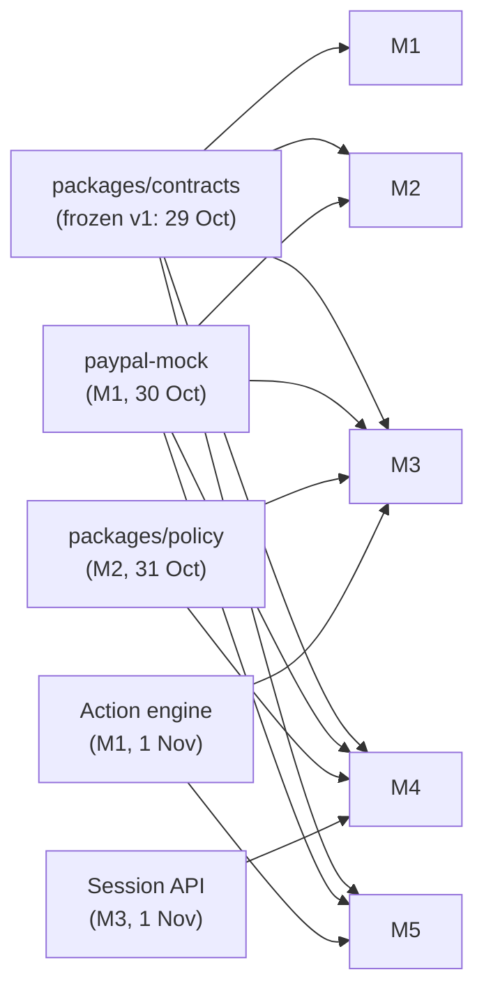

# Keepwell: Team Plan (5 members)

Deadline: **12 Nov 2026, 12:00 PM PT = 13 Nov, 01:30 IST.** Our own internal deadline: **submitted by 12 Nov, 20:00 IST.**
Judging: 1–15 Dec. Winners: around 21 Dec. The demo must stay up until then.

| Workstream | Owner | Branch prefix | Lead role |
|---|---|---|---|
| **M1 Rails**: PayPal platform and reliability | **Arnav** | `arnav/` | Release captain + infrastructure |
| **M2 Brain**: agent, policy, AI safety | **Ishan** | `ishan/` | AI safety + evals |
| **M3 Surfaces**: widget, portal, demo store, Judge Mode, MCP | **Aditya** | `aditya/` | Accessibility + i18n |
| **M4 Cockpit**: merchant dashboard, Bryntum timeline, onboarding | **Ayush** | `ayush/` | Design system + demo video |
| **M5 Growth**: recovery, win-back, insights, copilot | **Om** | `om/` | README + Devpost write-up |

To swap owners, edit this table and the matching table in `CLAUDE.md`. The **Representative** (the person who submits on Devpost) is Arnav. **All five must register for the hackathon on Devpost and be added to the submission.** Work items are GitHub Issues labelled `owner:<name>`, grouped by milestone.

---

## 1. The five workstreams

Each workstream is a full vertical: back end, front end where relevant, tests, docs, and its part of the demo. Each member also has one cross-cutting lead role. Effort estimates are in ideal working days, assuming heavy Claude Code use.

### M1 · Arnav: Rails (PayPal platform and reliability)
**Lead role: release captain and infrastructure.** Owns `main`, deploys and the on-call rota.

| Deliverable | Est. days |
|---|---|
| Monorepo scaffold, CI (typecheck, lint, test, gitleaks, OpenAPI diff), CODEOWNERS, Render + Neon environments | 1.0 |
| `packages/db`: Drizzle schema + migrations for platform tables | 0.5 |
| PayPal gateway: OAuth cache, typed client from PayPal's OpenAPI, retries, debug IDs, rate limiting | 1.0 |
| Webhook pipeline: raw ingest, verification, diff-of-truth processing, domain events | 1.5 |
| Action engine: state machine, per-subscription lock, read-before-retry idempotency, sagas (pause/resume, discount/revert) | 2.0 |
| Reconciler: hot loop, sweep, due-work sweep, nightly drift report | 1.0 |
| Hash-chained audit log + verify endpoint | 0.5 |
| `packages/paypal-mock` + fixture recorder | 1.0 |
| Seed script + **subscription pool** (lease/return, health job, Playwright refill tool) | 1.0 |
| Spikes Q2, Q6, Q10 | 0.5 |
| **Stretch X3:** upstream PR to `paypal/agent-toolkit` (suspend / activate / revise / capture) | 1.0 |
| **Total** | **≈ 11** |

**Done when:** Maya's pause runs on staging against real sandbox, survives killing the API mid-Action, and reconciles with zero drift.

### M2 · Ishan: Brain (agent, policy and AI safety)
**Lead role: AI safety and evals.** Final say on prompts, model choice and the LLM budget.

| Deliverable | Est. days |
|---|---|
| `packages/policy`: document schema, `computeMenu`, `evaluate`, `explain`, built-in PayPal rules | 1.5 |
| Property-based and unit tests for policy (100% branch coverage) | 1.0 |
| Agent runtime: Haiku classifier, Sonnet conversation with tool calls, streaming, session limits | 2.0 |
| Claims checker + template rendering for offer cards (en, hi, es) | 1.0 |
| Fallback levels L0/L1, budget guard, rate limits, prompt caching, `llm_usage` accounting | 1.0 |
| `packages/evals`: persona generator, simulated subscriber, 300 normal + 100 red-team personas, LLM judge rubric | 2.0 |
| Public `/evals` scoreboard page (data + simple page; styling help from M4) | 0.5 |
| Policy dry-run API for the dashboard | 0.5 |
| Spike Q4 | 0.5 |
| Prompt and eval iteration during hardening | 1.0 |
| **Total** | **≈ 11** |

**Done when:** a full eval run shows **0 policy violations** and **1 click to cancel** for every persona who wants to leave, with L1 fallback proven by revoking the API key.

### M3 · Aditya: Surfaces (everything subscribers and other agents touch)
**Lead role: accessibility and internationalisation.**

| Deliverable | Est. days |
|---|---|
| `packages/widget`: Preact + Shadow DOM, one script tag, SSE streaming, offer cards, Accept / No thanks / **Cancel now**, L1 reason chips, L2 static shell | 2.5 |
| Session HTTP + SSE module (`/sessions/*`), consent records | 1.0 |
| Subscriber identity: widget tokens, magic-link portal login, delegation tokens | 1.0 |
| Revise approval UX: popup / new tab, `/revise/return`, live waiting state | 0.5 |
| `apps/portal`: hosted cancel portal + delegation management | 0.5 |
| `apps/demo-store`: Pantry Plan site with JS SDK subscribe button, server-side verification, widget installed | 1.0 |
| `apps/judge`: Judge Mode page, leases, time machine, simulation badges | 1.0 |
| WCAG 2.2 AA pass (axe + keyboard + screen reader), voice input (X4) | 1.0 |
| **X1** subscriber-agent MCP + discovery doc; **X2** merchant MCP | 1.5 |
| Spikes Q3, Q7 | 0.5 |
| **Total** | **≈ 10.5** |

**Done when:** a judge can open Judge Mode, run all three scenarios without help, and Claude Desktop can pause a subscription through `/mcp/subscriber`.

### M4 · Ayush: Cockpit (merchant dashboard and onboarding)
**Lead role: design system and the demo video.**

| Deliverable | Est. days |
|---|---|
| `packages/ui` design tokens + `apps/dashboard` shell, merchant auth | 1.0 |
| Overview + live feed (SSE) | 1.5 |
| Subscribers list + detail page | 1.0 |
| **Bryntum Scheduler timeline** (sponsor prize) | 2.0 |
| Audit log explorer + "Verify chain" + decision explanations | 1.0 |
| Policy editor + dry-run simulator (runs `packages/policy` in the browser) | 1.5 |
| Onboarding wizard, full stack: credentials encryption, webhook registration, backfill | 1.5 |
| Spikes Q8, Q9 | 0.5 |
| Video: storyboard, recording, edit (with everyone's help on 11 Nov) | 1.0 |
| **Total** | **≈ 11** |

**Done when:** a fresh sandbox app can be onboarded in under 2 minutes, and every agent action can be traced from the timeline to the audit entry to the PayPal ID.

### M5 · Om: Growth (recovery, win-back, insights)
**Lead role: written submission and docs.** Owns the README, Devpost text and the docs site.

| Deliverable | Est. days |
|---|---|
| Recovery engine: dunning cases, reason-code playbooks, timing before PayPal's retry, capture on recovery | 2.0 |
| Win-back: external-cancel detection handler, single message, reply capture | 1.0 |
| Notifications outbox, Resend provider, frequency caps, unsubscribe, **Demo Inbox** API | 1.0 |
| Insights extraction (Haiku) + SQL aggregates/materialized views + overview KPIs SQL | 1.5 |
| Copilot with read-only tools, streaming | 1.5 |
| Insight-to-action: proposals, deterministic revenue estimate, approval → `create_plan` Action | 1.5 |
| Insights UI panels (built inside M4's dashboard shell using `packages/ui`) | 1.0 |
| **X5** churn-risk score | 0.5 |
| Spikes Q1, Q5 | 0.5 |
| README, architecture summary for judges, Devpost write-up | 1.0 |
| **Total** | **≈ 11.5** |

**Done when:** a failed payment produces a reason-specific message timed before PayPal's retry, recovered revenue appears on the dashboard, and the copilot proposes a plan that becomes a real PayPal plan after approval.

### Balance check

| | M1 Arnav | M2 Ishan | M3 Aditya | M4 Ayush | M5 Om |
|---|---|---|---|---|---|
| Core days | 10 | 11 | 9 | 11 | 11 |
| Stretch days | 1 | 0 | 1.5 | 0 | 0.5 |
| Lead role | Release captain | AI safety | A11y + i18n | Design + video | Docs + submission |

If anyone finishes early, the pull order for spare capacity is: (1) help M1 with sandbox end-to-end tests, (2) more red-team personas for M2, (3) polish on whatever the video shows.

---

## 2. Dependencies, and how nobody blocks

- Until a real dependency exists, **code against the interface in CONTRACTS.md with a fake.** Each owner ships a fake implementation of their interface on day 2 (for example `FakeActionEngine`, `FakeAgent`).
- paypal-mock means nobody needs sandbox credentials to start work.

---

## 3. Timeline (all dates IST)

| Date | Milestone | Everyone does |
|---|---|---|
| **Tue 28 Oct** | Kickoff | Read the three docs and `CLAUDE.md`. Accept the GitHub invite. Create the PayPal developer sandbox apps (Staging + Demo) and the Anthropic API key with a spend limit. Everyone registers on Devpost. |
| **Wed 29 Oct** | **Contracts v1 frozen** (23:59) | M1 scaffolds the repo. Everyone turns their section of CONTRACTS.md into zod in `packages/contracts`. Spikes start. |
| Thu 30 Oct | Spikes done | Answers in `docs/spikes/`; ADRs for anything that changes the design. paypal-mock with fixtures available. |
| **Sun 2 Nov** | **Walking skeleton** | On staging, real sandbox: Pantry Plan subscribe → widget → Claude conversation → pause offer → accept → suspend confirmed by webhook → visible in a bare dashboard. Ugly is fine. |
| **Wed 5 Nov** | **All three moments working end to end** | Cancel moment, recovery and win-back all run on staging. Dashboard shows real data. Eval harness gives its first scores. |
| Sat 8 Nov | **Feature freeze** (23:59) | Anything unfinished is cut by the cut list (section 5). |
| Sun 9 Nov | Chaos day + full eval run | Run section 9 of ARCHITECTURE.md; fix what breaks. Pool refill to 100+. |
| Mon 10 Nov | Hardening + promote to `prod-demo` | Accessibility pass, README, Judge Mode tested by someone outside the team. |
| Tue 11 Nov | **Video + write-up** | Record (M4 leads), Devpost text (M5 leads). Everyone reviews. |
| **Wed 12 Nov** | **Submit by 20:00 IST** | Final checklist (section 7). 5.5 hours of buffer before the real deadline. |
| 13 Nov – 30 Nov | Pool to 150+; monitoring | No code changes to the submitted project. |
| 1 – 15 Dec | Judging on-call | One person per day (rotation in section 6). |

Rituals:
- **Daily 15-minute stand-up** (fixed IST time): yesterday, today, blocked.
- **Demo every second evening:** each member shows their part running on staging, not on their laptop.
- **Shared channel** for "contract question" threads, so decisions are written down.

---

## 4. How we work with Claude Code

- **Root `CLAUDE.md`** holds the ten design laws, repo conventions, the commands (`pnpm test`, `pnpm dev`), and "never commit secrets; never call PayPal outside the gateway; never let the LLM touch cancel".
- **Each package has its own `CLAUDE.md`** with its owner, its invariants and its tests. For example `packages/policy/CLAUDE.md`: "pure functions only; every new rule needs a property test".
- **Work in your own package.** Touching someone else's package needs their review (CODEOWNERS enforces it).
- Use plan mode for anything over about 200 lines; run `/code-review` before opening a PR; keep PRs small (under about 400 lines changed) and merge daily.
- Use git worktrees if you run several Claude Code sessions in parallel.
- **Branching:** trunk-based. `main` is always deployable to staging. Short-lived branches named `<your-name>/<topic>`, e.g. `aditya/widget-sse`. Required checks: typecheck, lint, unit tests, contract diff, gitleaks.
- **Definition of done** for any feature: tests pass, works on staging against real sandbox (or is explicitly marked mock-only), audit entries written, failure behaviour matches the matrix, short note in the package README.

---

## 5. Cut list (applied at feature freeze, cut from the top first)

1. X5 churn-risk score
2. X4 voice input
3. X3 Agent Toolkit upstream PR (can still be opened later as a contribution, but not counted in the submission)
4. X2 merchant MCP
5. Hindi and Spanish templates (English only)
6. D7 hosted portal (widget only)
7. X1 subscriber-agent MCP. **Fight for this one:** it's the most novel part of the pitch.

**Never cut:** honest cancel, policy engine, action engine, verified webhooks + reconciler, audit log, recovery, dashboard core, Judge Mode, Bryntum timeline (the sponsor prize).

---

## 6. Judging-period on-call (1–15 Dec)

Rotate Arnav → Ishan → Aditya → Ayush → Om, one per day, repeating. The person on call:
1. Opens `/status` and the `/ops` page; checks the pool (≥ 40 available), budget and Sentry.
2. Runs Judge Mode scenario 1 once, as a judge would.
3. Fixes **ops only**: restart, pool refill, rotating an expired credential. **No code changes.** The rules allow changes to a submission after the deadline only with permission from the organisers, and only for narrow reasons such as removing infringing material.

---

## 7. Submission checklist (owner M5, verified by M1)

- [ ] Public GitHub repo, **MIT licence visible in the About section**
- [ ] README: what it is, architecture diagram, how to run locally (with paypal-mock and with sandbox), hosted demo URL, Judge Mode link, eval results, chaos report, honest note on anything simulated
- [ ] Hosted demo on `prod-demo` working from a clean browser
- [ ] **Test credentials** (sandbox merchant dashboard login + sandbox buyer account) in the submission form
- [ ] Public YouTube video **under 3 minutes**
- [ ] Devpost text: problem, solution, how PayPal is central, how AI is used, what's new since 1 October (the whole project), built with
- [ ] All five members added to the Devpost submission
- [ ] Sponsor prize opt-ins: Bryntum (and anything else we qualify for)
- [ ] Submitted by **12 Nov, 20:00 IST**
